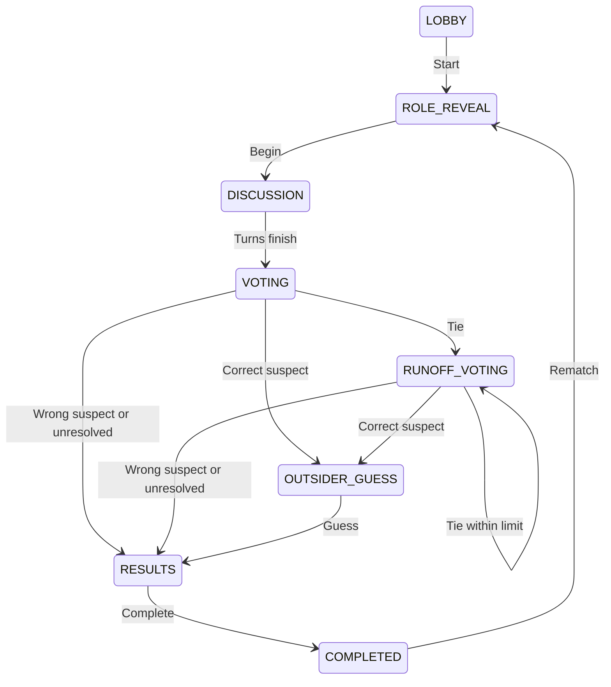

# Phase 4.2 — خارج الجو

## Scope and architecture

Game #2 is an isolated social deduction module on the hardened Phase 4.1.1 Qalba platform. It uses the existing signed-in host, `GameSession`, `Room`, `GameCommand`, credit wallet, analytics events, `DisplayAccess`, PostgreSQL/Prisma, and SSE approach. It has its own participants, rounds, votes, word bank, API routes and host, phone and TV components. Category Board rules and design tokens were not changed.

The host creates a room at `/games/out-of-the-loop/new`; 3–12 people join on individual phones. The server chooses one outsider and one published Arabic word using `crypto.randomInt`. Players discuss verbally in a fixed turn order, vote privately, and enter a runoff if the highest count is tied. A correctly identified outsider gets one final word guess. The host can pause/resume, advance turns, begin or close voting, complete or abandon the match. Rematch retains participants and issues a new private round, excludes the previous outsider, and prefers words outside the latest 20 rounds for the same host. A 55-word original seed covers 11 categories. Admins manage words at `/admin/secret-words`.

The first `START` charges one existing game credit atomically. Subsequent rematches in the same room do not charge again.

## Schema and state

Migration `20260930150000_social_deduction` adds `SecretWord` (category, difficulty, language, status and alternatives), `SocialParticipant` (session, name, order and token hash), `SocialRound` (word, outsider and outcome) and `SocialVote` (one record per voter and ballot). The new entities relate to generic `GameSession` and `Category`; no Category Board-specific fields are reused. `GameSession.state` stores only public social state. The secret and outsider ID live in `SocialRound` and are projected only to authorized recipients.

The domain transitions are:

Active phases may transition to `PAUSED` and resume at the saved phase; a host may end an active game as `ABANDONED`. The server rejects illegal phase changes, out-of-turn finishes, expired player turns, self votes, invalid runoff targets, unauthorized guesses and late joins. The default per-player timer is 30 seconds; the setup allows 20, 30, 45 or 60. The host can advance a timed-out turn. After two unresolved runoff ballots, the outsider wins; no random tie-break is used. A pure domain function normalizes Arabic presentation forms, common alif/ya/ta-marbutah variants, diacritics and whitespace for accepted words and admin alternatives.

## Privacy, concurrency and reconnection

`getSocialView` builds separate host, player and TV projections. During play the host and TV receive neither word nor outsider ID; the outsider receives no word. Before a ballot finishes, host/TV see a vote count but no target or voter mapping. After identification, a tally and suspect appear, while the word and outsider ID appear only with final results. The TV uses a time-limited, revocable, hashed display token; its endpoints are read-only and set a no-referrer policy. The host sees only link status, never the underlying private role or vote records.

Participant identity is a random 32-byte token in an HttpOnly, SameSite cookie, with only its hash stored in the database. Refresh/reconnect resolves the token to its own participant; a claimed player ID in a query is ignored. A failed or missing token cannot read another player's role. Each SSE stream sends an initial authorized projection, then checks state versions every second and emits heartbeat comments every ten seconds. It rechecks display access and closes on revocation; clients fall back to a read endpoint only when the stream fails.

Every important mutation accepts a UUID command key and expected state version. The unique `GameCommand(sessionId,key)` receipt is inserted in the same transaction as game state, role/word selection, votes and credit debit. Exact retries return `duplicate: true` without repeating effects; key reuse with another action is rejected. Optimistic `stateVersion` checks and the unique voter/ballot constraint serialize concurrent submissions. A stale client may refresh and retry a compatible `START` or vote using the same command key.

## Files changed

- Schema/content: `prisma/schema.prisma`, `prisma/migrations/20260930150000_social_deduction/migration.sql`, `prisma/seed.ts`, regenerated `src/generated/prisma/*`.
- Domain and service: `src/lib/games/social-deduction/{module,service,validation}.ts` and `module.test.ts`.
- HTTP: `src/app/api/social/**` and `src/app/api/admin/secret-words/**`.
- Pages/components: `src/app/social/**`, `src/app/games/out-of-the-loop/**`, `src/app/admin/secret-words/**`, `src/components/social-*.tsx`, `src/components/social-live.ts`, `src/components/secret-word-manager.tsx`.
- Integration: `src/app/games/page.tsx`, `src/app/admin/page.tsx`, appended social styles in `src/styles/components.css`, `next.config.ts`, `README.md`.
- Browser validation: `tests/e2e/social-deduction.spec.ts`; `scripts/e2e-with-db.mjs` runs the full suite in four sequential shards to bound development compiler memory.

## Validation

| Command | Result |
| --- | --- |
| `npm run lint` | Passed, exit 0 |
| `npm run typecheck` | Passed, exit 0 |
| `npm run test` | 61 passed across 15 files, including 12 new social domain tests |
| `DATABASE_URL='postgresql://localhost:5432/qalba' npm run build` | Passed, 25 static pages generated |
| `npm run test:e2e:db -- social-deduction.spec.ts` | 6 passed in 1.7 minutes |
| `npm run test:e2e:db` | 26 passed, exit 0; sequential shards: 7 + 9 + 4 + 6. All 20 existing tests passed. The isolated PGlite database applied all 10 migrations and seeded content. |

The six new browser scenarios cover four private phone roles, correct accusation and wrong final guess, wrong accusation, TV privacy and link revocation, runoff, duplicate and concurrent commands, a live TV stream beyond 30 seconds, rematch/reconnection, phone width, and admin word CRUD/archive. Existing Category Board tests remain in the full suite.

## Remaining limitations

- The server owns the deadline, but a timed-out turn awaits a host advance; there is no background scheduler to advance it automatically.
- Live streams check the database once per second per connected client. A high-scale deployment should use shared pub/sub while keeping authorization and version checks.
- Word administration supports individual create/edit/archive and alternatives; bulk import and additional roles/modes are deferred.
- Participant room and cookie expire after eight hours; a rematch must occur within the same room lifetime.
