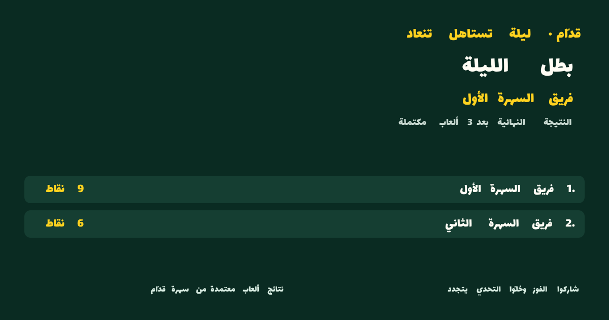
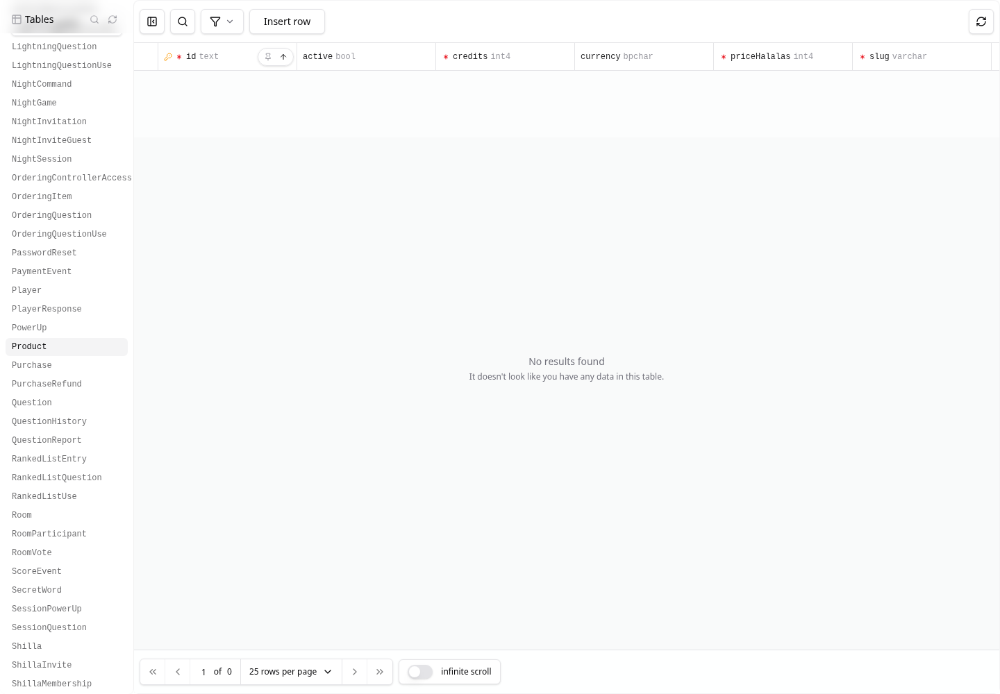
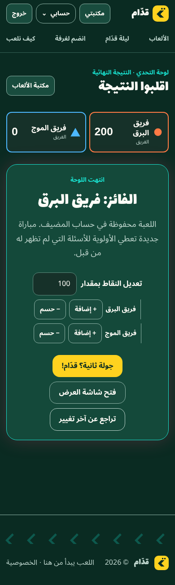
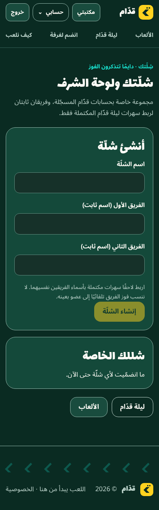

# Quddam — Beta completion verification

**PARTIAL للسبرنت، وNO-GO للـBeta الخارجية المتكاملة المطلوبة حاليًا.** نجاح الاختبارات المحلية لا يوافق على الدمج أو الإطلاق. يبقى [PR #13](https://github.com/7assan-0/quddam/pull/13) Draft وغير مدموج؛ لم يُعدّل main أو تُدمج الفروع أو يُفعّل دفع أو بريد أو تُنشأ خدمة خارجية. التكلفة الخارجية الجديدة **$0**.

## المصدر والأدلة

- الفرع: `feature/shillatak-private-leaderboard`؛ الرأس الفعلي عند البدء `e0474a685b3892525f4ddecd26be497a5d3045dc`، وليس SHA مفترضًا.
- القاعدة: PR #12 عند `35d970c3b91246e850dda23b6adeee93213889b6` فوق PR #10 عند `90c98d376d9b727ca704c3e7da91b96e600f2de1`. PR #9 مسار مستقل عند `ca25d2e9dd51dc806f0591ff199aeb711b694806` فوق PR #8، ولم يُدمج هنا. كانت جميعها Draft/open/unmerged عند التحقق المستقل من GitHub.
- main المقروء فقط: `c5fbb232fb1fa54b5b3128c80b8dafa33cc79e7d`.
- **SHA النهائي الحرفي ونتائج إعادة التشغيل النهائية:** في [تصريح أدلة PR #13](https://github.com/7assan-0/quddam/pull/13#issuecomment-6211466061). هذا رابط خاص بهذه المهمة؛ لا يعيد استخدام إيصال PR #12. يتضمن التصريح هوية commit/tree وجرد الملفات/الأوضاع وبصمته قبل التشغيل وبعده. وجود التقرير داخل commit يمنع تضمين SHA ذلك commit داخل نصه دون تغيير البصمة؛ التصريح الخارجي يحسم الهوية حرفيًا.
- نتائج التشخيص أثناء التعديل تحمل `sourceDirty: true` صراحةً. لا يُقدّم SHA الأب على أنه يثبت بايتات التعديل. يشترط الحكم النهائي إعادة التشغيل بعد آخر تعديل وتطابق المصدر الحرفي قبلها وبعدها؛ لا تُورث موافقة RC التاريخية أو نجاح أي مرشح سابق.
- يحتفظ المجلد الخاص `/tmp/quddam-beta-t7ffn653` بالأدلة الخام بصلاحيات مقيدة، خارج Git. لا تنشر ملفات `*.private.*` أو HAR أو traces أو صور حقول روابط الدعوة أو كلمات مرور الاختبار. تنشر الخلاصة المنقحة فقط.

## العيوب التي أُصلحت

| العيب المثبت | التغيير وسبب ضرورته | دليل الرجوع |
| --- | --- | --- |
| قبول شكل إنشاء غير صحيح عند استدعاء خدمة الشلّة مباشرة | تطبيق schema الصارم داخل الخدمة أيضًا | حالات وحدة رفض الحقول/الأشكال غير المعتمدة |
| وقت إنشاء الدعوة محسوب قبل انتظار قفل المجموعة | حساب الساعة والحد والصلاحية بعد القفل؛ سبعة أيام كاملة من القرار المقبول | PG17 انتظار قفل فعلي وعبور حد الانتهاء |
| الاعتماد على تطابق حقل digest دون إعادة حساب كامل إيصال Night | التحقق من شكل الإيصال ومصدره/إصداره/اللعبة وترتيب scores→placements وإعادة تكوين digest بترتيب ثابت؛ رفض الحالة الناقصة بـ409 | 28 اختبار قواعد/خدمة بعد التصحيح؛ عينات مشتقة من نتائج حقيقية، JSONB بترتيب مفاتيح مختلف، ورفض النسخ المتعارضة |
| استمرار كشف اسم مجموعة خاصة عبر دعوة مغلقة لغير عضو | 404 للدعوة المستهلكة/الملغاة/المنتهية/المؤرشفة؛ استعادة وصول العضو الحالي فقط | وحدة وPG وChrome؛ لا إعادة استهلاك الرمز |
| JOIN يتجاهل body تالفًا أو حقول سلطة | قراءة stream بحد 4096 بايت وقبول `{}` فقط قبل القبول | قبل التصحيح: 6 فشل/18 نجاح API؛ بعده 24/24 |
| تعذر إكمال مسار دعوة شلّة من متصفح غير مسجل | تسجيل/دخول inline مع مسار عودة allowlist محدد، دون raw token في query تسجيل الدخول أو sessionStorage؛ العضوية تتطلب تأكيدًا مستقلًا | SSR وallowlist واختبارات UI ورحلة Chrome |
| قائمة إلغاء الدعوات لا تتحدث فور إنشاء رابط، وبقاء الرابط الخام ظاهرًا بعد الإلغاء | قراءة metadata بعد INVITE مع الحفاظ على الرد السري الناجح عند فشل GET؛ مسح الرابط عند REVOKE/ARCHIVE/refresh | Chrome قبل الإصلاح أعاد العيب؛ اختبارات UI بعده |
| hydration خاطئ عند اختلاف منطقة الخادم والمتصفح | أول عرض UTC مطابق لـSSR، ثم منطقة المتصفح الصريحة عبر `useSyncExternalStore`؛ كل التواريخ تستخدم المنطقة نفسها | Chrome قبل الإصلاح: React418 فعلي في Asia/Riyadh مقابل UTC؛ اختبار SSR فاشل قبل الإصلاح |
| تجاوز حقول شلّتك عرض 390px إلى 419px | استخدام `.input` و`.field` المعتمدتين بدل class غير معرف، دون CSS عام أو تغيير هوية | Chrome الموقع فشل بعد 75 تحققًا بسبب overflow؛ SSR فشل 1/نجح 7 قبل التصحيح ثم أعيد |
| ضياع عرض رمز غرفة اللوحة بعد تحديث المنظّم | استعادة من endpoint المالك الموجود دون تغيير محرك أو صلاحيات | Chrome قبل الإصلاح فشل عند غياب `.room-code`؛ رحلة بعد الإصلاح مطلوبة |

قبل التصحيح فشلت مجموعة قواعد/خدمة الشلّة **15 حالة ونجحت 13**؛ بعده **28/28**. فحص SSR لصفحة الدعوة فشل **3 ونجح 1** ثم أصبح **4/4**. هذه أعداد مجموعات تشخيص مختلفة، ولا تُجمع مع مجموعة Vitest الكاملة بوصفها اختبارات مستقلة.

البصمة غير الموقعة تثبت اتساق الإيصالات المخزنة؛ لا تحمي من مدير قاعدة بيانات يغير البيانات والبصمات معًا. لم تُخترع سياسة تفرد لأسماء الشلل: الممنوع تساوي **اسمي الفريقين** بعد التطبيع، وحد الخمس يشمل المجموعات المؤرشفة.

## البيئة وإعادة التنفيذ

- Node `24.19.0`، npm `11.9.0`، PostgreSQL **17.11**، Google Chrome for Testing **155.0.8059.79**، Next `16.3.6`، Prisma `7.10.0`.
- قاعدة جديدة معزولة `night_mvp_beta_t7ffn653`؛ الحاوية المملوكة `quddam-beta-t7ffn653`، منفذ `127.0.0.1:56545` فقط. فُحصت هوية القاعدة والإصدار و**صفر جداول تطبيق قبل أول migration**؛ طُبقت **27 migration** بنجاح. لم يُعدل schema أو أي migration في هذا التصحيح.
- مصدر الصورة: `postgres@sha256:2d2b8998d31037bf721cfdf764d76ba74171b4fab3431b7f72c27c56ddbdf9e3`. توجد credentials المولّدة خارج Git فقط. لا تمرر URL في argv أو الدليل المنشور.
- بيانات اصطناعية فقط. seeding الأولي مرة واحدة؛ ممنوع إعادة seed لقاعدة محتفظ بها أو تصفيرها. helpers الجديدة تضيف حسابات/محتوى اختبار إلى قاعدة marker المتحقق منه؛ لا تمس بيانات موجودة حقيقية.
- Chrome headless فعلي عبر HTTP وNext مبني على `127.0.0.1:3000`؛ لا responses وهمية في الرحلة العادية. تعطيل sandbox خاص بحاوية اختبار Chrome فقط، دون تعطيل TLS أو web security.
- نجح تشغيل `next start` المحلي المبني؛ **ليس NOT RUN ولا محظورًا** في هذه الجلسة. لم يُختبر deployment launcher أو HTTPS أو استعادة snapshot على جهاز جديد.

بعد قراءة حراس scripts وضبط ملفات البيئة الاصطناعية الخاصة فقط، الأوامر المنفذة/المعاد تنفيذها في `qalba-platform`:

```sh
npm ci
npm run db:generate
# بعد فحص قاعدة PG17 الاختبارية الجديدة وهويتها فقط:
npm run db:migrate
npx vitest run src/lib/shillatak/rules.test.ts src/lib/shillatak/service.test.ts src/app/api/shillatak/route.test.ts 'src/app/shillatak/join/[code]/page.test.tsx' src/components/shillatak.test.tsx src/lib/auth/return-path.test.ts src/proxy.test.ts --reporter=verbose
npm run test -- --maxWorkers=1 --retry=0
npm run typecheck
npm run lint
npm run build
node --import tsx scripts/beta-shillatak-postgres.ts
node --import tsx scripts/night-phase4-postgres.ts
node scripts/night-phase4-chrome.mjs
node scripts/beta-shillatak-chrome.mjs
node scripts/beta-site-chrome.mjs
node --import tsx scripts/beta-restart.ts
```

كل تشغيل acceptance يتطلب `NIGHT_MVP_SYNTHETIC=1` وملف البيئة الخاص 0600 و`NIGHT_MVP_OUTPUT` خارج المستودع. حراس الاتصال تقبل loopback واسم قاعدة fixture وmarker المطابق فقط. `ENABLE_NIGHT_OF_QUDDAM=true` و`ENABLE_SHILLATAK=true` محليًا في العملية فقط. اختر اسم تشغيل جديدًا لكل محاولة؛ لا تكتب فوق إيصال سابق. يتطلب Chrome مسار Chrome الحقيقي، `BASE_URL` المحلي، وعند الحاجة `NIGHT_MVP_CHROME_NO_SANDBOX=1` في حاوية الاختبار.

- native Shillatak: `BETA_NATIVE_RUN`؛ إن احتاجت قاعدة جديدة تمامًا حسابات fixture إضافية فاقرأ `beta-fixtures.ts --seed-beta` أولًا، ولا تستخدم `--seed` الموروث على قاعدة مهيأة.
- Night: `NIGHT_PHASE4_RUN`؛ Chrome يقرأ `NIGHT_PHASE4_NATIVE_RUN` الجديد لإنشاء صور التعادل/الإنهاء المبكر من النتائج الفعلية.
- Shillatak Chrome: `BETA_NIGHT_RUN` يشير إلى نجاح Night من **SHA الحالي نفسه** و`BETA_SHILLATAK_CHROME_RUN` اسم جديد؛ لا تُشغّل كاتب رصيد آخر على مالك fixture أثناء مقارنة ledger.
- Site Chrome: يستخدم حسابًا اصطناعيًا مستقلًا مسجلًا بالواجهة ومحتوى لوحة اصطناعيًا؛ helper المنح يضيف ثلاث وحدات عبر الأمر الإداري المعتاد، لا SQL لتغيير wallet.
- Restart: `BETA_EXPECTED_SHA` حرفي و`BETA_NIGHT_RUN` و`BETA_SHILLA_RUN` وإخراج `BETA_RESTART_RUN`. يتطلب منفذ 3000 خاليًا ويتحقق من المصدر حرفيًا، ثم يوقف عملياته المملوكة فقط. لا يزرع أو يمنح أو يغير نتائج.
- ربط المصدر: `python3 ci/financial-review/source-binding.py <git-root> <literal-full-SHA>` من جذر المستودع قبل المجموعة وبعدها. يعتمد على Git objects لا status/index، ويعطل replacement objects. لا يشمل جرد المصدر المخرجات المولدة المستثناة؛ فحوص build وChrome مستقلة.

## بوابات الاختبار — النتيجة النهائية يحسمها تصريح SHA

| البوابة | نتيجة التشغيل التشخيصي الجديد | نطاق الاستنتاج |
| --- | --- | --- |
| تثبيت مقفل + Prisma generate | PASS، خروج 0 | يعاد التثبيت والتوليد على الالتزام النهائي |
| migrations على PG17 جديدة | PASS، 27 migration | ليست ترقية قاعدة إنتاج أو تجربة recovery |
| Shillatak/Proxy/Auth/UI محدد | PASS، 78/78 في 7 ملفات بعد تصحيح الجوال | يعاد على الرأس النهائي |
| Full Vitest | PASS، **1479/1479** في **89 ملفًا**، صفر failed/skipped/todo | لا يثبت وحده الشبكات أو الجاهزية الإنتاجية |
| TypeScript / ESLint / production build | PASS في الفحوص التشخيصية | الإعادة النظيفة الأخيرة والتوقيت في التصريح |
| native Shillatak | PASS، **24/24** | ثمانية حواجز تنازع فعلية، 3 backends/2 ينتظران لكل حاجز |
| native Night invitations | PASS، **18/18** | START↔RSVP بالترتيبين، 3 backends/2 ينتظران |
| Chrome Night | PASS، **54/54** | تسجيل دخول، RSVP وتصويت، 5+7+5 جولات أصلية، highlights وPNG |
| Chrome Site | PASS، **83/83** بعد تصحيح الجوال | 8 ضيوف مستقلين، 18 خلية، 200–0 للجميع، غرفة جديدة بلا انتقال نتائج |
| Chrome Shillatak / Restart | نتائج الإعادة والتفاصيل الحرفية في تصريح الأدلة | لا يُستنتج PASS من كتابة harness |
| Studio | PASS، PG **10/10** + HTTP/BFF **10/10** + Chrome **7/7** | إعداد عارض محلي مخصص، ليس نشرًا |
| audit production | FAIL، **2 High affected package nodes**، صفر Critical | لا تخفيه نتيجة الاختبارات الناجحة |
| audit جميع الاعتماديات | FAIL، **14 affected nodes**: 1 Critical/10 High/3 Moderate | عقد حزم، وليست 14 ثغرة مستقلة بالضرورة |
| PR #9 مستقل | نتيجة جديدة منفصلة في خطة الدمج | لا تثبت مصدر PR #13 أو تكامل المحركات |
| PR #9 + Night مصدر مدمج | **NOT RUN** | الدمج غير معتمد ولم يُنفذ |
| جهازان LAN / NAT مختلفة / ساعة اتصال حقيقية | **NOT RUN** | لا معدات/شبكة مصرح بها؛ لا Firewall/CA/listener عام |
| الألعاب الست الأخرى كاملة | **NOT RUN** | محتواها غير مزروع في قاعدة الاختبار؛ هذا ليس حكمًا على بيانات الإنتاج |
| rollback لمخطط Shillatak بعد وجود تاريخ immutable | **NOT RUN** | لا مسار downgrade معتمد، ولا تعطيل trigger أو حذف تاريخ |
| live payments / merchant / public deployment / load/recovery | **NOT RUN** | خارج نطاق الموافقة، ولا موافقة إطلاق كاملة |

محاولتا Shillatak Chrome التشخيصيتان سجلتا **27 تحققًا ناجحًا ثم FAILED**؛ لم تُمح النتائج. كُشف عيبان في harness: انتظار JSON لرد logout بعد انتقال الصفحة، ومطابقة `role=alert` العامة لعنصر خطأ الشبكة وإعلان تنقل Next معًا. أُضيفت deadlines وضُبط selector داخل واجهة الانضمام مع نص خطأ الشبكة نفسه؛ لا يُخفف شرط POST الحقيقي المقبول ثم قطع الرد، ورفض إعادة استهلاك الرمز واستعادة العضوية بعد refresh. اختبارات الاستكمال الجزئية ليست بديلًا عن إعادة الرحلة الكاملة على الرأس النهائي.

تُحتفظ المحاولات الفاشلة كذلك: اختبار الاستعادة قبل الإصلاح، hydration قبل الإصلاح، وفرضيات harness الخاطئة. اختبارات native لا تعطل trigger عدم تغيير النتائج؛ محاولات SQL UPDATE/DELETE تفشل ويُعمل ROLLBACK. عينات الإيصال التالفة نسخ في الذاكرة من سجلات أصلية، لا تعديل دائم لنتائج اللعب.

## PostgreSQL والصلاحيات والرصيد

native يغطي حدود 5 شلل/5 دعوات نشطة/20 عضوًا، قبولين يتنازعان دعوة واحدة، REVOKE↔ACCEPT وARCHIVE↔ACCEPT بالترتيبين، الانتهاء بعد انتظار القفل، ATTACH مكرر في المجموعة نفسها وATTACH للسهرة نفسها بين مجموعتين. يُرفض الطلب المتعارض عند تنازع مقعد أو رمز أو ربط بين مجموعتين. أما ATTACH المكرر في المجموعة نفسها فينجح الطلبان بأثر واحد، وACCEPT ثم ARCHIVE يمكن أن ينجحا مع بقاء العضوية في التاريخ المؤرشف؛ لا تتضاعف العضوية أو لقطة البطولة.

لُعبت في native أربع سهرات من المحركات الأصلية: فوز `9–6`، تعادل `8–8`، فوز معكوس `6–9`، وحالة السباق بين مجموعتين. بعد ثلاث سهرات تتساوى رتبة الفريقين: بطولتان و23 نقطة وثلاث مشاركات لكل فريق. **12 START debit فقط** لألعاب السهرات الأربع؛ كل إنشاء/دعوة/قبول/ربط/إعادة/إلغاء/مغادرة/أرشفة شلّة يضيف صفر خصم. تختلف هذه fixtures عن نتائج رحلة Chrome.

رحلة Chrome Night الجديدة تلعب الجولات الأصلية `5/7/5` وتثبت debit واحدًا لكل START، وتربط النتيجة المكتملة بالشلّة صراحةً. رحلة لوحة الموقع تستخدم لعبة مختلفة وحسابًا مستقلًا: START واحد فقط، والدعوة والانضمام والاستعداد والنتيجة بلا خصم إضافي. لم يتغير billing أو الأسعار أو خصم START أو محركات الألعاب أو Night core/adapters/service أو migrations السابقة. مخطط إضافة Shillatak الموجود من قبل محفوظ دون تعديل.

JOIN الصارم لا يقبل ownerId أو نقاطًا؛ روابط الشلّة لا تمنح سلطة Night، واسم RSVP ليس عضوية. العضو لا يدير INVITE/REVOKE/ATTACH/ARCHIVE، والمالك لا يغادر عبر تجاوز سياسة نقل الملكية. الخروج يسقط قراءة المجموعة؛ الأرشفة تحفظ التاريخ ولا تعني الحذف. HTTP Same-Origin و`private, no-store` و`no-referrer` و`noindex` لا تثبت تنقيح access logs مستقبلية.

## Database Viewer

العارض **http://localhost:5555** داخل بيئة العمل السحابية فقط. `localhost` على جهاز المالك الشخصي عنوان مختلف؛ لم يُنشأ tunnel أو توجيه عام. راجع [دليل العارض والجداول](beta-database-viewer.md) للروابط والعلاقات وإعادة التشغيل الآمنة.

يعمل بدور PostgreSQL `quddam_beta_viewer` بامتياز SELECT فقط؛ محاولات INSERT/UPDATE/DELETE وDDL وتصعيد الدور تفشل حتى بعد تعطيل `transaction_read_only`. زر Insert row موجود في Studio، لكن قاعدة البيانات تمنع الكتابة فعليًا. تظل بيانات الاختبار وStudio وPG متاحة بعد انتهاء الاختبار؛ لا ضمان بقاء `/tmp` أو العمليات بعد استعادة البيئة.

كُشفت محاولة telemetry في Studio، ولم تكفِ `CHECKPOINT_DISABLE=1` وحدها لعميل المتصفح. أضيف preload خارجي خاص بعملية العارض يفرض `connect-src 'self'`؛ أثبت Chrome منع المحاولة قبل إرسال طلب خارجي. لم يتغير التطبيق أو TLS أو Firewall. التفاصيل والبصمة والأدلة في الدليل؛ لا يُنسب هذا السلوك إلى إعداد Prisma الافتراضي.

## الواجهات وتكامل الغرف

حُفظت هوية قدّام الحالية، ولم يُنفذ redesign. تختبر رحلة الموقع العرض الفعلي لا مجرد loading boundary: الصفحات العامة، إعدادات الألعاب العشر، الحساب والتسجيل والدخول، refresh واستعادة الغرفة، ثم لوحة كاملة ونتائجها. تُراجع RTL وعرض 390px وعدم horizontal overflow؛ لا يُستنتج منها اختبار جميع الأجهزة أو قارئات الشاشة.

تختبر رحلة Shillatak الواجهة الفعلية لإنشاء مجموعة، إنشاء/نسخ دعوة، حساب عضو مستقل، الدخول/التسجيل والقبول، الصلاحيات، ربط نتيجة Night والتعادل المحسوب في native، تحديث قائمة الدعوات، الإلغاء، المغادرة والأرشفة. فقدان رد القبول اختبار fault معلّم: POST الحقيقي يلتزم ثم يُقطع الرد؛ لا responses backend مصطنعة ولا قبول تلقائي. أخطاء HTTP المتوقعة من probes السلبية وERR_ABORTED أثناء navigation/SSE تُعد وتُصنف، ولا يكتب التقرير «صفر أخطاء» بإطلاق.

الغرفة الموجودة في هذا الفرع **HTTP/SSE للوحة التصنيفات، 20 ضيفًا و8 ساعات**، والهوست لا يحتل مقعد ضيف. مختبر PR #9 **WebRTC تسعة لاعبين و60 دقيقة ثابتة والهوست لاعب**؛ ليس محرك Night. راجع [مقارنة الفروع وخطة الدمج الآمن](beta-room-integration-plan.md). لا يكفي عدم تقاطع أسماء الملفات للقول إنهما متكاملان. لا تُمزج صلاحية RSVP أو عضوية الشلّة أو قدرة RTC مع سلطة محرك اللعبة.

قرارات مرئية محفوظة للمالك: كيفية إظهار مسار الغرفة الحالية مقابل المختبر بعد اختيار التكامل، ومعنى المشاركة/الهوست في فريقي Night، وموضع دخول موحد للغرف. لا تغيير هوية أو أسعار أو شاشة جديدة بلا ضرورة.

## الموانع والقرارات المطلوبة قبل Beta حقيقية

1. **P0 — الرحلة المطلوبة ليست متكاملة بعد:** PR #9 منفصل عن Night وShillatak؛ يلزم اعتماد خطة الدمج، سلطة اللعب وهوية الفريق/المقعد والعمر والاستعادة، ثم دمج مراجَع واختبارات على المصدر المدمج. لا ننفذ `git merge` في هذا السبرنت.
2. **P0 — اعتماديات عالية الخطورة:** Next الحالي وتنبيه transitive في production، وVitest UI Critical في أدوات التطوير. لم يُشغل UI server. التحديث الحساس يحتاج موافقة وفق قيد المهمة؛ [مراجعة الأمان](beta-security-gates.md) تحدد الإصدارات المرشحة والتحقق من registry ومعايير الإغلاق. لا `audit fix --force` أو ترقية خفية.
3. **P0 قبل التعرض — حدود زمنية وخصوصية تشغيلية:** حدود عدد الشلل/الأعضاء/الدعوات ليست limiter زمنيًا؛ إنشاء دعوة ثم إلغاؤها يسمح بتراكم غير محدود. يلزم اعتماد ميزانيات زمنية ذرية، وتطبيقها واختبارها، وإثبات تنقيح روابط الدعوات من logs. لا نختار سياسة جديدة أو نعتمد ذاكرة Next عملية واحدة.
4. **قرار مالك — الاحتفاظ والمحو والتصدير ونقل الملكية:** السجلات المعتمدة immutable؛ لا تعطيل trigger أو SQL workaround أو حذف نهائي ذاتي. الأرشفة والمغادرة ليستا سياسة حذف مكتملة.
5. **P0 إطلاق سابق باقٍ:** audited PENDING-hold resolution، تنفيذ monitoring/alerting والتحقق منهما، merchant verification، وبوابات successor release الكاملة. هذا العمل لا يغلقها ولا يعيد استخدام موافقة RC قديمة.
6. **تشغيل وشبكات:** HTTPS وأجهزة LAN وNAT مختلف وload والنسخ/الاسترجاع واستعادة إعداد البيئة على آلة جديدة لم تُثبت. يلزم قرار آمن مستقل قبل listener خارج loopback أو CA/Firewall أو STUN/TURN أو استضافة.
7. **محتوى وتجربة جميع الألعاب:** إعدادات الألعاب العشر اختُبرت، لكن الجولات الكاملة للست غير المزروعة في fixture لم تُلعب. يلزم محتوى اصطناعي معتمد أو فحص خاص منفصل دون دخول إنتاج.

هدف 14 يومًا **مشروط بالقرارات والنتائج**، وليس موعد تسليم مضمونًا: أولًا مراجعة هذا Draft وإغلاق اعتماديات/limiter/privacy بمهام صغيرة معتمدة؛ ثم تكامل الغرف بمراجعة مستقلة؛ ثم إعادة PG/Chrome والـledger على المصدر المدمج؛ وأخيرًا LAN/NAT والتشغيل والقبول الخاص. لا يُبدأ أي دمج أو نشر أو مورد مدفوع تلقائيًا. البوابة المحلية الناجحة تسمح بمراجعة المالك، ولا تجعل النسخة الحالية Beta خارجية مكتملة.

## أدلة بصرية منقحة

هذه الصور روجعت بصريًا، وولدت من بيانات اصطناعية في هذه الجلسة. صور بطاقات Night من التشغيل التشخيصي الجديد `beta-night-chrome-preliminary` قبل الالتزام؛ لا يُقدّم تاريخ توليدها على أنه تنفيذ على SHA النهائي. تُعاد رحلة التنزيل والفحص على الرأس النهائي ويسجل التصريح نتائجها. لا تحتوي رموز دعوة أو cookies أو معرفات جلسات.










## الملفات المعدلة في هذا التصحيح

المسارات التالية داخل `qalba-platform/`، بالإضافة إلى المصدر الموجود سابقًا في PR #13. يرفق التصريح النهائي diff حرفيًا مقابل رأس البدء. ملف `next-env.d.ts` يعاد إلى بايتاته الملتزم بها بعد التحويل المولد المعروف؛ ليس تصحيح تطبيق.

| الملف | سبب التغيير |
| --- | --- |
| `docs/beta-database-viewer.md` | تشغيل العارض المقيد وجدول العلاقات وخصوصية Studio. |
| `docs/beta-readiness-verification.md` | نتائج السبرنت، حدودها وقرار Beta. |
| `docs/beta-room-integration-plan.md` | مقارنة PR #9 وخطة تكامل غير منفذة ونتائج المختبر المستقلة. |
| `docs/beta-security-gates.md` | التنبيهات المؤكدة وقرارات التحديث والحدود والسياسات المحجوزة للمالك. |
| `docs/evidence/beta/board-eight-guests-results-mobile.png` | لقطة اصطناعية منقحة روجعت بصريًا، موصوفة كتوليد تشخيصي قبل الالتزام. |
| `docs/evidence/beta/night-champion.png` | لقطة اصطناعية منقحة روجعت بصريًا، موصوفة كتوليد تشخيصي قبل الالتزام. |
| `docs/evidence/beta/night-cochampions.png` | لقطة اصطناعية منقحة روجعت بصريًا، موصوفة كتوليد تشخيصي قبل الالتزام. |
| `docs/evidence/beta/shillatak-mobile.png` | لقطة اصطناعية منقحة روجعت بصريًا، موصوفة كتوليد تشخيصي قبل الالتزام. |
| `docs/evidence/beta/studio-readonly-empty-products.png` | لقطة اصطناعية منقحة روجعت بصريًا، موصوفة كتوليد تشخيصي قبل الالتزام. |
| `docs/shillatak-mvp-acceptance.md` | تمييز المواصفات التاريخية من أدلة التنفيذ وتصحيح سياسة الأسماء. |
| `scripts/beta-fixtures.ts` | fixture اصطناعية إضافية بحراس قاعدة PG17، دون إعادة seed. |
| `scripts/beta-restart.ts` | إعادة تشغيل وتعطيل flags على مصدر حرفي دون تغيير بيانات. |
| `scripts/beta-shillatak-chrome.mjs` | رحلة واجهة Shillatak فعلية وفقدان رد قبول معلّم. |
| `scripts/beta-shillatak-postgres.ts` | قبول PostgreSQL أصلي وسباقات وقواعد نتائج ورصيد. |
| `scripts/beta-site-chrome.mjs` | رحلة الموقع/الجوال والغرفة الحالية وثمانية ضيوف ونتائجها. |
| `scripts/beta-site-fixtures.ts` | محتوى لوحة اصطناعي إضافي ومنح fixture بالأمر الإداري المعتاد. |
| `src/app/api/shillatak/join/[code]/route.ts` | تطبيق فحص JOIN قبل استهلاك الدعوة. |
| `src/app/api/shillatak/route.test.ts` | اختبارات رجوع للصلاحيات أو أنواع الإدخال أو الإيصالات أو SSR/الواجهة. |
| `src/app/shillatak/[id]/page.tsx` | إخراج JSX خارج catch مع الإبقاء على معالجة الصلاحيات. |
| `src/app/shillatak/join/[code]/page.test.tsx` | اختبارات رجوع للصلاحيات أو أنواع الإدخال أو الإيصالات أو SSR/الواجهة. |
| `src/app/shillatak/join/[code]/page.tsx` | عرض المصادقة inline أو دعوة العضو حسب الجلسة. |
| `src/components/auth-form.tsx` | مسار عودة اختياري محدود للواجهة مع بقاء تسجيل الدخول المعتاد. |
| `src/components/room-host-panel.tsx` | استعادة رمز غرفة المالك بعد تحديث الصفحة فقط. |
| `src/components/shillatak-group.tsx` | تحديث الدعوات ومسح الرابط السري واتساق التوقيت وتوضيح رابط الاستخدام الواحد. |
| `src/components/shillatak-home.tsx` | إصلاح تجاوز عرض نموذج الجوال باستخدام تنسيق المشروع. |
| `src/components/shillatak-join-auth.tsx` | مصادقة inline تحافظ على مسار الدعوة بلا قبول عضوية تلقائي. |
| `src/components/shillatak-join.tsx` | استعادة وصول العضو بعد فقدان الرد مع بقاء القبول أحادي الاستخدام. |
| `src/components/shillatak.test.tsx` | اختبارات رجوع للصلاحيات أو أنواع الإدخال أو الإيصالات أو SSR/الواجهة. |
| `src/lib/auth/return-path.test.ts` | اختبارات رجوع للصلاحيات أو أنواع الإدخال أو الإيصالات أو SSR/الواجهة. |
| `src/lib/auth/return-path.ts` | allowlist حرفي لمسار عودة الدعوة، ورفض التحويل الخارجي. |
| `src/lib/shillatak/http.ts` | قراءة body JOIN بحد الحجم وشكل صارم. |
| `src/lib/shillatak/rules.test.ts` | اختبارات رجوع للصلاحيات أو أنواع الإدخال أو الإيصالات أو SSR/الواجهة. |
| `src/lib/shillatak/rules.ts` | فحص إدخال الخدمة واتساق إيصالات Night وإعادة حساب بصمتها. |
| `src/lib/shillatak/service.test.ts` | اختبارات رجوع للصلاحيات أو أنواع الإدخال أو الإيصالات أو SSR/الواجهة. |
| `src/lib/shillatak/service.ts` | ساعة بعد القفل وحماية preview الدعوة المغلقة واستعادة العضو الحالي. |
