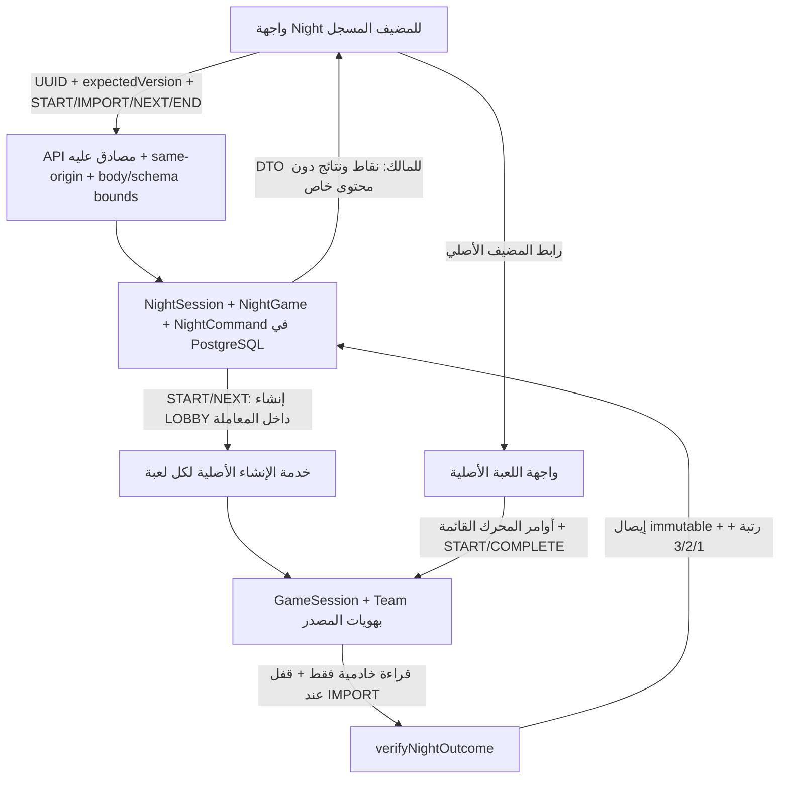

# ليلة قدّام — تقرير تنفيذ MVP

تاريخ التقرير: ١٥ أكتوبر ٢٠٢٦. نطاقه Draft [PR #10](https://github.com/7assan-0/quddam/pull/10)، على فرعه المستقل عن تجربتي PR #8 وPR #9. الميزة معطلة افتراضيًا، ولا يمنح هذا التقرير موافقة دمج أو نشر أو تشغيل مدفوع.

**القرار لنطاق MVP المحلي: PASS.** معرّف SHA النهائي الحرفي، شجرة Git، جرد المصدر وبصمته، ونتائج إعادة التشغيل على ذلك الرأس موجودة في [إيصال التحقق النهائي](https://github.com/7assan-0/quddam/pull/10#issuecomment-6189964395). هذا الرابط هو موضع SHA النهائي لتجنب مرجع ذاتي يتغير عند كتابته داخل الالتزام نفسه. يجب أن يطابق SHA الإيصال رأس PR؛ أي تحديث لاحق يحتاج تحققًا جديدًا. نتائج المرشحين السابقين، واختبار غرف PR #9، لا تتحقق من هذا المصدر.

## النتيجة الوظيفية المقصودة وحدود النسخة

إنشاء سهرة محفوظة، اختيار ترتيب ثلاث ألعاب رسمية، تثبيت فريقين، تجهيز مباراة كل لعبة عبر خدمتها الأصلية، لعب الجولات كاملة، اعتماد النتيجة من PostgreSQL، عرض نقاط السهرة بين الألعاب، ثم إعلان بطل واحد أو أبطال متعادلين بعد اعتماد المباريات الثلاث. إنهاء السهرة مبكرًا يحفظ النتائج المعتمدة ويعرض أنها غير مكتملة دون بطل.

الألعاب المتكاملة هنا فقط: **توب 100** (`top-list`؛ خمس جولات)، **رتّبها** (`ordering-challenge`؛ سبع جولات)، **قالوا الناس** (`survey-show`؛ خمسة أسئلة). كلها تستخدم فريقين ثابتين وخدمات منفصلة ونتائج محفوظة. لا يحتاج الربط إلى نقل أسئلة أو مفاتيح إجابات إلى Night، ولا إلى مسار Generic Party المتقاعد. يتطلب «رتّبها» صفحتي تحكم منفصلتين للفريقين. تتضمن «قالوا الناس» تحكيم المضيف، وأوزان الإجابات محتوى محرر للعبة وليست نتائج استطلاع حقيقي. اعتماد هذه النتائج يعني التحقق من سجلات المحرك المصرح به؛ لا يعني حكمًا تنافسيًا مستقلًا عن المضيف.

النواة الخالصة تحتفظ بقواعد ٣–١٠ ألعاب رسمية و٢–٣ فرق، لكن الخدمة والواجهة المتاحتين خلف العلم تقبلان هذه الألعاب الثلاث المختلفة وفريقين فقط. ليست بقية الألعاب مدعومة لمجرد قبول slug رسمي في دالة القواعد الخالصة.

## فحص توافق الألعاب العشر

المرجع الحاكم للمسارات الرسمية هو [`launch-policy.ts`](../src/lib/games/launch-policy.ts). جرى فحص خدمات ومحركات الألعاب أدناه. «ربط ممكن لاحقًا» يعني أن مصدر النتيجة موجود، وليس أن له adapter أو تحققًا فعليًا في Night الحالي. عمود الرصيد يصف السلوك القائم: خصم لعبة واحدة في أمر المحرك `START`، وليس إنشاء السهرة أو `NEXT`.

| اللعبة | الهوية والعدد | الإنشاء الرسمي والخدمة | الاكتمال ومصدر النتيجة | قرار الربط | حدود السرية والثقة | الرصيد القائم |
|---|---|---|---|---|---|---|
| لوحة التحدي `category-board` | فريقان؛ ٦ فئات × ٣ خلايا | `POST /api/games/category-board`؛ `category-board/service.ts:createBoardSession` | `GameSession.status=COMPLETED` و`BoardState.completed`؛ نقاط `Team` و`ScoreEvent`، مع فصل `endedEarly` والتحرير اليدوي | مؤجلة؛ تحتاج سياسة تثبت اكتمال اللوحة واستبعاد الإنهاء المبكر/تعديل النقاط، إضافةً لاختيار الفئات | `questionSnapshots` تتضمن إجابات؛ المضيف يحكم ويمكنه `EDIT_SCORE`، فلا تُنسخ الحالة الخام | لعبة واحدة عند `START` |
| خارج الجو `out-of-the-loop` | أفراد ٣–١٢؛ فئة الفائز `PLAYERS` أو `OUTSIDER` | `POST /api/social`؛ `social-deduction/service.ts:createSocialSession` | `COMPLETE` بعد `RESULTS`؛ `SocialState.winner` و`SocialRound`، وليست لوحة فريقين ثابتين | غير متوافقة مع هوية فريقين في هذا MVP؛ لا تُخترع مطابقة من أفراد إلى فرق | الكلمة والهوية السرية خاصة بكل لاعب ومرحلة؛ المضيف لا يصبح لاعبًا تلقائيًا | لعبة واحدة عند `START` |
| شبكة الحروف `letter-network` | فريقان؛ لوحة ٥×٥ | `POST /api/letter-network`؛ `letter-network/service.ts:createLetterSession` | `COMPLETED` بعد `RESULTS`؛ `winnerTeamId` و`winningPath`؛ الالتقاط ليس جمع نقاط اعتياديًا | مؤجلة؛ يلزم تحقق من مسار الفوز الطبيعي وتمييز `END_GAME` دون بطل | الإجابات وتقييمها عند المضيف؛ الحالة العامة لا تحمل مفتاح الإجابة | لعبة واحدة عند `START` |
| قالوا الناس `survey-show` | فريقان؛ خمسة أسئلة | `POST /api/survey-show`؛ `survey-battle/service.ts:createSurveySession` | `COMPLETED` بعد `COMPLETE`؛ درجات `Team` تطابق `state.scores`، استخدامات الأسئلة الخمسة وسجل الانتقال الطبيعي | **متكاملة**؛ adapter يتحقق من المباراة الأولى الكاملة والمضاعفات `[1,1,2,2,3]` وهويات الفرق | المضيف يرى الإجابات ويحكم؛ Night لا يستقبلها. ليست استطلاعات مستقلة | لعبة واحدة عند `START`؛ الإعادة الحالية داخل الجلسة مجانية، لكن Night لا يعتمد مباراة معادة |
| الكلمة الممنوعة `secret-word` | فريقان؛ ٦ جولات، ٣ لكل فريق | `POST /api/secret-word`؛ `forbidden-word/service.ts:createForbiddenSession` | `COMPLETED` بعد `FINAL_RESULTS`؛ `state.scores` و`Team` وسجل البطاقات/الأحكام | ممكنة لاحقًا؛ لم ينفذ adapter؛ يلزم تمييز اكتمال الجولات من نفاد المحتوى | الكلمة والبطاقات المحظورة خاصة بمقدم التلميحات؛ قرارات المضيف جزء من النتيجة | لعبة واحدة عند `START` |
| صدّقني `bluff` | أفراد ٣–١٢؛ خمس جولات | `POST /api/bluff`؛ `bluff/service.ts:createBluffSession` | `COMPLETED` بعد `FINAL_RESULTS`؛ درجات `BluffParticipant` ونتائج التصويت والأجوبة، لا درجات فريقين | مؤجلة؛ تحتاج عقد هويات أفراد ونقاط منفصلًا عن هذا MVP | الإجابة الصحيحة ونسبة الأجوبة لأصحابها والتصويت محجوبة حسب المرحلة والدور | لعبة واحدة عند `START` |
| توب 100 `top-list` | فريقان؛ خمس جولات | `POST /api/ranked`؛ `ranked/service.ts:createRankedSession` | `COMPLETED` بعد `COMPLETE`؛ خمس نتائج جولات تجمع إلى `state.scores` ودرجات `Team`، واستخدامات قوائم منتهية | **متكاملة**؛ مصدر كامل ومحدد وعدد جولات ثابت، دون تعديل قواعد المحرك | تخمينات وتطابقات يقررها المحرك؛ المضيف يدير الأدوار والكشف ونهاية الجولة؛ لا تنقل قوائم الإجابات إلى Night | لعبة واحدة عند `START`؛ لا خصم لإنشاء LOBBY |
| البرق `lightning-quiz` | فريقان؛ جرس مستقل لكل فريق؛ ١٥ سؤالًا | `POST /api/lightning`؛ `lightning/service.ts:createLightningSession` | `COMPLETED`؛ `state.results` و`scores` ودرجات `Team`، مع نتيجة السؤال الملغى/الإنهاء المبكر | مؤجلة؛ ممكنة، لكنها تحتاج تحققًا خاصًا من ١٥ سؤالًا والإلغاء وهوية صلاحية الجرس، وليست اختيارًا تلقائيًا | مفتاح الإجابة خاص بالمضيف؛ رابط الجرس مقيد بالفريق ويجب ألا يورث صلاحيات الإدارة | لعبة واحدة عند `START` |
| رتّبها `ordering-challenge` | فريقان؛ ٧ جولات؛ ٤–٨ عناصر؛ صفحتا تحكم | `POST /api/ordering`؛ `ordering/service.ts:createOrderingSession` | `COMPLETED` بعد `COMPLETE`؛ سبع نتائج، مقاييسها تجمع إلى درجات `Team`، واستخدامات أسئلة منتهية | **متكاملة**؛ نتائج محفوظة وهوية كل فريق وترتيب الجولة واضحان | ترتيب الفريق الآخر والترتيب الصحيح محجوبان حتى الكشف؛ Night لا ينقل أيًا منهما | لعبة واحدة عند `START`؛ إنشاء روابط التحكم يخضع لمحرك اللعبة القائم |
| المحكمة `the-court` | فريقان + ٣–١٢ محلفًا | `POST /api/court`؛ `court/service.ts:createCourtSession` | `COMPLETED`؛ خمس نتائج وأصوات/أحكام `CourtRound.scoreAudit` ودرجات `Team` مع `voided` | مؤجلة؛ ليست جلسة فريقين فقط، وتحتاج تثبيت أهلية المحلفين وتحقق الإلغاء والاكتمال الطبيعي | المحلفون أصحاب صلاحيات تصويت منفصلة؛ لا تُنسخ اختياراتهم الفردية أو رموزهم إلى Night | لعبة واحدة عند `START` |

روابط الدليل لكل صف: [`category-board`](../src/lib/games/category-board/service.ts)، [`social-deduction`](../src/lib/games/social-deduction/service.ts)، [`letter-network`](../src/lib/games/letter-network/service.ts)، [`survey-battle`](../src/lib/games/survey-battle/service.ts)، [`forbidden-word`](../src/lib/games/forbidden-word/service.ts)، [`bluff`](../src/lib/games/bluff/service.ts)، [`ranked`](../src/lib/games/ranked/service.ts)، [`lightning`](../src/lib/games/lightning/service.ts)، [`ordering`](../src/lib/games/ordering/service.ts)، [`court`](../src/lib/games/court/service.ts). قواعد العدد والحالات تفصيلها في `module.ts` المجاور لكل خدمة.

## الربط والسلطة ومقاومة تكرار الأثر



السير المحفوظ: `preparing → START → playing → IMPORT → NEXT → … → IMPORT → completed`، أو `END → ended` دون إعلان بطل. يحتفظ `currentIndex` بموضع المباراة الحالية حتى `NEXT`. الواجهة تستطلع GET للقراءة كل ثانيتين وتطلب `IMPORT` عند تحقق `importReady`؛ لا تضع نتيجة أو نقاطًا أو معرف مصدر في أمر المتصفح.

يعيد GET الحالة من قاعدة البيانات بعد التحديث أو إعادة تشغيل التطبيق. معرفا فريقي Night ثابتان؛ تربطهما مصفوفة محفوظة بمعرفي `Team` في كل محرك حسب الموضع والاسم. لا تستخدم `localStorage` أو `sessionStorage` مصدرًا للهوية أو السلطة أو النتيجة.

تأخذ أوامر السهرة قفل صف Night قبل مقارنة الإصدار. ويأخذ `IMPORT` قفل `GameSession` أيضًا، ثم يتحقق من المالك وslug وحالة `COMPLETED` وتوقيت البدء/الانتهاء واستهلاك الرصيد وهوية الفريقين والمباراة الأولى وعدد الجولات والسجل الطبيعي. تُرفض شاشة `FINAL_RESULTS` وحدها، أو مصدر من مالك/جلسة أخرى، أو `REMATCH`، أو أي `END_GAME`، أو بيانات متعارضة/ناقصة. تستخدم «توب 100» و«رتّبها» جمع نتائج الجولات لمقارنة درجات المحرك. في «قالوا الناس» لا توجد مصفوفة نتائج كاملة في المحرك؛ يعتمد التحقق على الجولات الخمس وسجل `NEXT_ROUND` والمضاعفات والحالة النهائية المتسقة، مع إبقاء ثقة تحكيم المضيف واضحة.

تحسب النواة نقاط السهرة من الترتيب فقط: الأول ٣، الثاني ٢، الثالث ١. التعادل يتبع Competition Ranking؛ مثال ثلاثة فرق في اختبار القاعدة: `[أ، ب]` أولًا يمنحهما ٣ لكل منهما، ثم الثالث يأخذ ١. الواجهة تعرض ترتيبًا مشتركًا ونقاطًا مشتركة عند التعادل النهائي؛ لا تختار بطلًا بالاسم أو معرف الفريق.

مفتاح UUID للأمر مربوط ببصمة المحتوى والمالك والإصدار؛ إعادة المحاولة بالمفتاح والمحتوى نفسيهما لا تنشئ مباراة أو تخصم رصيدًا أو تضيف نتيجة مرتين. تغيير المحتوى مع المفتاح نفسه مرفوض. يحتفظ المتصفح بالمفتاح والمحتوى نفسيهما عند غموض الشبكة ويعطل الأوامر الأخرى حتى التحقق. يبقى الخادم مصدر الحسم حتى عند إغلاق الصفحة أو تعدد التبويبات.

كل مصدر مرتبط بسهرة واحدة عبر قيد فريد. بعد ربط المصدر أو قبول الإيصال تمنع trigger تغيير الهوية/الإيصال أو حذف سجل اللعبة؛ وسجل الأوامر immutable أيضًا. لا توجد واجهة لتصحيح نتيجة معتمدة أو تغيير المصدر. إعادة لعب المصدر لاحقًا لا تعيد كتابة النتيجة المحفوظة؛ محاولة اعتماد متعارضة تُرفض. لذلك تظهر تعليمات إكمال الجولات ثم «أكمل المباراة» وعدم استخدام الإنهاء اليدوي أو الإعادة داخل مباراة السهرة.

## الملفات المتغيرة وسببها

الجرد أدناه لمسارات تنفيذ MVP؛ يجب مقارنته بجرد Git النهائي في الإيصال قبل اعتماد النتيجة.

| المجموعة | الملفات | السبب |
|---|---|---|
| النواة وعقد البيانات | `src/lib/night/core.ts`, `catalog.ts`, `types.ts`, `lifecycle.test.ts` | مراحل التجهيز/اللعب/الإنهاء والانتقال الصريح، قائمة الألعاب المتكاملة، DTO وعقود الأوامر واختبارات القواعد |
| تحقق النتيجة والتخزين | `src/lib/night/adapters.ts`, `adapters.test.ts`, `service.ts`, `service.test.ts` | قراءة النتيجة الأصلية والتحقق منها، قفل وتكرار آمن وربط فريقين وإيصالات محفوظة |
| Prisma | `prisma/schema.prisma`, `prisma/migrations/20261015210000_night_mvp/migration.sql` | إضافة جداول السهرة والربط والأوامر وقيودها دون تحرير migration تاريخية |
| إنشاء الألعاب ضمن معاملة | `src/lib/games/ranked/service.ts`, `src/lib/games/ordering/service.ts`, `src/lib/games/survey-battle/service.ts` | استخراج إنشاء الجلسة الأصلي إلى دالة تقبل المعاملة، مع إبقاء إنشاء اللعبة المنفصلة وسلوك `START` المالي كما هما |
| API | `src/lib/night/http.ts`, `src/app/api/night/route.ts`, `src/app/api/night/route.test.ts`, `src/app/api/night/[id]/route.ts`, `src/app/api/night/[id]/commands/route.ts` | حدود JSON الصارمة، المصادقة وsame-origin والمالك وDTO المنقح؛ لا مدخل لنتائج المتصفح، واختبارات الحدود |
| واجهات السهرة | `src/app/night/page.tsx`, `src/app/night/new/page.tsx`, `src/app/night/[id]/page.tsx`, `src/components/night-of-quddam-setup.tsx`, `night-of-quddam.tsx`, `night-of-quddam.test.tsx` | إنشاء وترتيب ثلاث ألعاب، نفس الفريقين، لوحة محفوظة وانتقال ونتيجة وبطل/تعادل وإنهاء غير مكتمل |
| الدخول والعودة | `src/app/layout.tsx`, `src/app/games/page.tsx`, `src/components/night-return-link.tsx`, وصفحات `src/app/ranked/host/[id]/page.tsx`, `src/app/ordering/host/[id]/page.tsx`, `src/app/survey-show/host/[id]/page.tsx` | روابط خلف العلم؛ العودة من سجل الربط المملوك في الخادم دون query-string أو صلاحية مخزنة في المتصفح |
| قبول معزول | `scripts/night-mvp-fixtures.ts`, `night-mvp-engines.ts`, `night-mvp-postgres.ts`, `night-mvp-chrome.mjs` | بيانات اصطناعية محلية وأوامر المحركات الأصلية، PostgreSQL أصلي وتزامن وChrome حقيقي؛ لا تشغيل تلقائي مع التطبيق |
| التوثيق | `docs/night-of-quddam-mvp-results.md`, `docs/night-of-quddam-migration.md` | حدود التكامل وإجراء التحقق والنتائج، وخطة تعطيل التطبيق والرجوع دون إتلاف سجلات التدقيق |

ملفات التحقق والتعطيل الإضافية: `src/proxy.ts` و`src/proxy.test.ts` يحجبان صفحات Night قبل بث layout عند غياب العلم، دون تغيير matcher تجاوز API/SSE أو صلاحيات البرق. `scripts/night-mvp-restart.ts` يختبر ثلاث عمليات Next جديدة واستعادة PostgreSQL وChrome والتعطيل الافتراضي. صورتا `docs/evidence/night-of-quddam-mvp/transition.png` و`champion.png` من رحلة Chrome فعلية ناجحة، وقد روجعتا بصريًا؛ لا تحتويان إجابات أو بيانات حساب أو capabilities.

لم تُنقل تجربة P2P إلى Night. لم تتغير قواعد المحركات العشرة أو نظام الدفع أو ملفات RC المعتمد التاريخية ضمن هذا النطاق؛ يلزم تثبيت ذلك بجرد diff النهائي، لا بمجرد نجاح الاختبارات.

## أثر التخزين والرصيد والصلاحيات

- التخزين الجديد: `NightSession` للمالك والحالة والإصدار، `NightGame` للترتيب والمصدر ومطابقة الفرق والإيصال، `NightCommand` للتكرار الآمن. لا migration هدمية، ولا تغيير تاريخي لسجلات الألعاب أو المحافظ.
- إنشاء Night و`START/NEXT` للسهرة يجهزان LOBBY فقط، و`IMPORT/END/GET` لا تخصم رصيدًا. الخصم الوحيد للعب يأتي من `consumeGameCredit` في `START` للمحرك الأصلي داخل معاملته الحالية. لا night pass أو تسعير جديد أو تجاوز مالي. إنهاء السهرة لا يلغي المباراة الأصلية ولا يرد رصيدها.
- كل الصفحات وواجهات API مصادَق عليها ومقيدة بالمالك. معرف سهرة صحيح لا يمنح حسابًا آخر الوصول. لا يوجد Night guest/public/spectator endpoint في MVP.
- DTO يحمل أسماء الفرق وترتيبها ونتائج السهرة وروابط المضيف المصادق عليها؛ لا يحمل الأسئلة أو الإجابات أو ترتيب الحل الصحيح أو كلمات السر أو tokens. يطبق API `private, no-store` و`no-referrer` و`noindex`، وحدّ جسم ٤٠٩٦ بايت، وطلبات POST من الأصل نفسه فقط.
- الروابط من الألعاب إلى Night تُحل في مكون خادمي من العلاقة المحفوظة والمالك واللعبة ومعرف الجلسة؛ ليست تلميحًا من عنوان URL، ولا تغير صلاحية اللاعب أو شاشة العرض.
- لا سقف ٦٠ دقيقة خاص بـNight في هذه النسخة. مدة غرف PR #9 تخص تجربة غير مستوردة؛ مؤقتات الألعاب الأصلية تبقى مستقلة. لا يُدَّعى أن الهوست حكم محايد أو أن هذا يثبت نزاهة منافسات مدفوعة.

## إجراء تحقق محلي قابل للإعادة

استخدم نسخة نظيفة من SHA الذي سيذكره الإيصال وPostgreSQL أصليًا **محليًا معزولًا** وقاعدة جديدة باسم `night_mvp_<suffix>`. لا تستخدم قاعدة تطبيق قائمة أو بيانات أو اعتمادات تاجر حقيقية. يرفض harness العمل في `NODE_ENV=production`، أو دون `NIGHT_MVP_SYNTHETIC=1`، أو إذا لم تكن قاعدة الاختبار loopback باسم Night المخصص. ملف البيئة الخاص ومجلد الأدلة خارج checkout، بصلاحيات 0600/0700؛ لا تُنشر محتوياتهما.

مع إعداد `DATABASE_URL` محليًا بصورة خاصة، و`NIGHT_MVP_ENV_FILE` لمسار JSON الخاص نفسه، و`NIGHT_MVP_OUTPUT` لمجلد خارجي فارغ، و`ENABLE_NIGHT_OF_QUDDAM=true` في عملية الاختبار فقط:

```sh
npm ci
npm run db:generate
npm run db:migrate
node --import tsx scripts/night-mvp-fixtures.ts --seed
npx vitest run src/lib/night src/components/night-of-quddam.test.tsx --reporter=verbose
node --import tsx scripts/night-mvp-postgres.ts
npm run typecheck
npm run lint
npm run build
```

`db:migrate` هنا مخصص لقاعدة Night الاصطناعية الجديدة فقط. محتوى الأسئلة والأجوبة الاصطناعي يُستخدم عبر المحركات الأصلية ثم يبقى في قاعدة الاختبار الخاصة؛ لا توجد `db push` على قاعدة قائمة أو كتابة مباشرة إلى نتائج `GameSession` في مسار رحلة القبول.

بعد البناء، شغّل خادم التطوير على loopback فقط مع `APP_URL` مطابق لأصل المتصفح، ثم Chrome الرسمي عبر Playwright. `npm run dev` الافتراضي يربط `0.0.0.0`؛ لذلك استخدم الاستدعاء الصريح:

```sh
node node_modules/next/dist/bin/next dev --hostname 127.0.0.1 --port 3000
node scripts/night-mvp-chrome.mjs
```

يحتاج harness إلى `BASE_URL` محلي مطابق و`CHROME_EXECUTABLE` لمسار Google Chrome الفعلي، وإلى متغيرات العزل أعلاه. لا يستخدم mock للطلبات أو المحرك. تُلعب خمس/سبع/خمس جولات من الواجهات الأصلية، وصفحتا «رتّبها» بصلاحيتيهما المنفصلتين. أي أسرار اختبار أو روابط تحكم تبقى خاصة، وتُلتقط الأدلة المنقحة من لوحة Night فقط، دون traces/HAR أو نشر مفاتيح الإجابات. تعاد إجراءات PostgreSQL/Chrome بأسماء مجلدات أدلة جديدة بدل الكتابة فوق تجربة سابقة.

لاختبار إعادة تشغيل التطبيق، أوقف فقط خادم loopback الذي أنشأته أنت، ثم مرّر `NIGHT_MVP_JOURNEY_FILE` إلى `journey.private.json` الناتج عن رحلة Chrome الناجحة، واختر `NIGHT_MVP_RESTART_RUN` جديدًا وشغّل `node --import tsx scripts/night-mvp-restart.ts`. يرفض الاختبار منفذًا مشغولًا بدل قتل مستمع آخر، ويبدأ/يوقف مجموعاته الثلاث الخاصة فقط، ويصدر GET دون أمر START. فحوص GET القائمة قد تحاول idempotent welcome upsert؛ يثبت الإيصال أن الحالة المحفوظة لم تتغير، ولا يدّعي غياب كل عبارة SQL DML.

## سجل التحقق

جميع الأعداد أدناه من تنفيذ محلي فعلي، لا من مرشح سابق. أعيدت الفحوص على الالتزام الحرفي المحدد في الإيصال الخارجي بعد تثبيت المصدر. استُخدم Node 24.19.0 وnpm 11.9.0 وNext 16.3.6 وPostgreSQL 17.11 وGoogle Chrome for Testing 155.0.8059.79. جرد Git الحرفي قبل الفحوص وبعدها يستخدم `ci/financial-review/source-binding.py` مع SHA الجديد؛ لا يقرأ manifest المرشح القديم أو يورّث موافقته. يستثني الجرد مخرجات التوليد المعلنة، ولا يدّعي التحقق منها كأصول إصدار معتمدة.

| الفحص | النتيجة المحلية | الدليل والنطاق |
|---|---|---|
| `npm ci` من lockfile | PASS، خروج 0 | تثبيت فعلي نظيف؛ لا تعديل package/lockfile |
| `npm run db:generate` | PASS، خروج 0 | Prisma المولد للمخطط الجديد |
| migrations | PASS، خروج 0 | تطبيق forward على قاعدة PostgreSQL 17.11 جديدة اصطناعية فقط؛ لا reset أو إنتاج |
| اختبارات Night وAPI والواجهة وProxy | **55 ناجحًا، 0 فاشل، 0 متجاوز** | core 5 + lifecycle 2 + adapters 12 + service 6 + API 16 + UI 7 + Proxy 7؛ ضمن المجموعة الكاملة |
| كامل Vitest | **1,344 ناجحًا، 0 فاشل، 0 متجاوز في 76 ملفًا** | جرد الاختبارات الفعلي المكتشف؛ يشمل المحركات الأصلية والرصيد والدفع دون تغيير قواعدها |
| native PostgreSQL Night | **29 تحققًا ناجحًا، 0 فاشل** | عشر مباريات كاملة عبر الخدمات الأصلية، ست حالات تزامن بقنوات PostgreSQL مستقلة، وسبع محاولات تعديل/حذف مرفوضة بسجلات لم تتغير |
| `npm run typecheck` | PASS، خروج 0 | المخطط والواجهة وharness الجديد |
| `npm run lint` | PASS، 0 أخطاء، تحذير قائم واحد | المتغير `baseline` غير مستخدم في `scripts/staging-arm64-pg17-ci.mjs:62`؛ الملف لم يتغير |
| `npm run build` | PASS، خروج 0 | بناء إنتاج فعلي؛ لا يثبت تشغيل خادم إنتاج |
| Chrome الكامل | **27 تحققًا ناجحًا، 0 فاشل** | إنشاء من المكتبة، ترتيب الألعاب، لعب 5/7/5 جولات، اعتماد آلي، نفس الفرق، تحديث الصفحة، انتقال، وبطل 9–6 |
| Chrome: الحدود | PASS ضمن 27 | رفض نقاط المتصفح 400، أصل آخر 403، حساب مالك آخر 404، غير مسجل 401؛ سهرة إضافية انتهت دون بطل أو خصم |
| إعادة تشغيل التطبيق وChrome | **13 تحققًا ناجحًا، 0 فاشل** | ثلاث عمليات Next مملوكة للاختبار، استعادة DTO مطابق وهويات وإصدار ونتائج وبطل؛ العلم غائب فعلًا يعيد 404؛ مكتبة 10 ألعاب وصفحة المضيف تبقيان تعملان |
| خادم إنتاج `next start` | **NOT RUN** | استُخدم Next dev على loopback؛ لا يُستنتج تشغيل الإنتاج من Build |
| جهازان فعليان/LAN/شبكات مختلفة | **NOT RUN** | لا يثبت Chrome على جهاز واحد النقل بين شبكات مختلفة |
| قبول Night/PostgreSQL/Chrome مستضاف | **NOT RUN** | الفحوص المخصصة المذكورة محلية؛ أي workflow تلقائي له نطاقه وإيصاله المستقل |
| نشر/دفع/بريد حي/migration إنتاجية | **NOT RUN وغير مصرح** | لم تُنفذ |

التزامن الأصلي يغطي START المكرر، IMPORT المكرر، START قبل END والعكس، وIMPORT قبل REMATCH والعكس. إذا سبق IMPORT فنتيجة المباراة الأولى ثابتة رغم إعادة المباراة الأصلية المجانية لاحقًا؛ وإذا سبق REMATCH يُرفض الاعتماد ولا تُضاف نتيجة. تؤكد triggers رفض إعادة كتابة مطابقة الفرق والإيصال وسجل الأوامر؛ المحاولات السلبية محاطة بمعاملات rollback في القاعدة الاصطناعية، ولا يوجد مسار منتج لتجاوزها.

في Chrome سُجلت درجات المحركات الفعلية: توب 100 **39–36**، رتّبها **70–0**، قالوا الناس **900–0**؛ طبّعها Night إلى **3–2** لكل مباراة ثم **9–6**. استُخدمت صفحتا تحكم حقيقيتان منفصلتان لرتّبها. الخصم النهائي ثلاث ألعاب عبر START الأصلي فقط؛ إنشاء Night وتجهيز LOBBY والانتقال والاعتماد والإنهاء لا تضيف خصمًا. لا requests mocks ولا كتابة مباشرة إلى حالة نهاية مباراة أو درجاتها.

أخطاء Chrome في الرحلة الناجحة: **0 استثناءات صفحات و0 أخطاء Console**. سجلت الرحلة الأولية الناجحة ثلاث عمليات `net::ERR_ABORTED` لاتصالات SSE عند مغادرة صفحات الألعاب، مصنفة ومحفوظة وليست مخفية. الإيصال النهائي يسجل العدادات بعد إغلاق المتصفح وpool أيضًا، ويميز إلغاء التنقل/التنظيف عن الأخطاء الأخرى. تعمل Chrome headless؛ تعطيل sandbox خاص بحاوية الاختبار فقط، دون تعطيل TLS أو web security.

نجحت استعادة التطبيق بعملية جديدة وسياق Chrome جديد، ثم تعطيله دون تغيير بصمة بيانات Night/الجلسات التابعة/المحفظة/دفتر الرصيد/auth/analytics. كانت أول محاولة إعادة التشغيل تكشف HTTP 200 لصفحة notFound المبثوثة؛ صُحح الحجب المبكر في Proxy ثم أعيدت التجربة الصارمة دون تخفيف شرط 404.

سجل الإخفاقات التشخيصية محفوظ منفصلًا: 16 فشلًا أوليًا في اختبارات auth/admin نتجت من APP_URL غير مطابق لأصل localhost الثابت في الاختبارات؛ عاد كامل الجرد ناجحًا بعد تصحيح بيئة التشغيل، دون تغيير توقعاتها. فشلت أربع محاولات Chrome أولية بسبب محددات روابط مكررة وتسمية select المتداخلة؛ صُححت أداة الاختبار وأعيدت الرحلة كاملة. فشل TypeScript أثناء التطوير قبل توليد Prisma وبسبب cast لاختبار مدخلات متعمدة السوء؛ صُحح التوليد والكتابة النوعية ثم أعيد الفحص. هذه المحاولات ليست نتائج قبول ناجحة ولا تُحذف أدلتها الخاصة.

[صورة الانتقال الفعلية](evidence/night-of-quddam-mvp/transition.png) · [صورة بطل الليلة الفعلية](evidence/night-of-quddam-mvp/champion.png). الصور من رحلة ناجحة قبل تثبيت الالتزام؛ الإيصال الخارجي المنفصل هو مرجع التحقق المعاد على SHA النهائي، لا الصورة وحدها.

## التعطيل والرجوع الآمن

العلم `ENABLE_NIGHT_OF_QUDDAM` يحتاج القيمة الحرفية `true`، وهو معطل عند غيابه. تعطيله يحجب صفحات Night وواجهاته وروابط الدخول/العودة دون تغيير تشغيل الألعاب المنفصلة. يتوقف الاستطلاع/الاعتماد الآلي عند مغادرة الواجهة؛ لا توجد cron أو import خفية.

الرجوع الآمن يبدأ بتعطيل العلم وإيقاف قبول أوامر Night الجديدة، ثم التحقق من عدم وجود معاملة Night جارية قبل استبدال شيفرة الخدمة. تبقى الجداول والروابط والإيصالات والأوامر محفوظة. يمكن أن تستمر مباراة أصلية سبق تجهيزها عبر محركها المصادق عليه؛ تعطيل Night لا يخترع نتيجتها ولا يلغيها ولا يرد رصيدها. عند العودة إلى إصدار يدعم Night، تُستعاد السهرة من السجلات ويُعاد فحص النتيجة قبل أي اعتماد.

لا تحذف جداول Night أو trigger التدقيق أو سجلاتها كطريقة رجوع بعد وجود بيانات. لا يوجد down migration تلقائي أو إجراء تعديل/حذف يدوي للنتائج. إزالة المخطط ممكنة فقط لقاعدة الاختبار الفارغة القابلة للاستبدال، أو بخطة احتفاظ/تصدير وموافقة منفصلة على التعامل مع السجلات الحقيقية. وجود migration قابلة للإضافة لا يجيز تطبيقها على الإنتاج في هذه المهمة.

## المتبقي والميزات غير المنفذة

لم تنفذ بعد: بقية adapters السبعة، فرق Night الثلاثة في المنتج، أفراد Night، وضع الجمهور، دعوة/تصويت RSVP، شلّتك ولوحة الشرف، هايلايتس، بطاقة مشاركة، وأسئلة جماعتك. لم تضاف P2P أو STUN/TURN أو signaling أو خدمة خارجية أو تسعير. تبقى خارطة [البرنامج المعتمد](night-of-quddam-roadmap.md) خطة المراحل التالية، لا وصفًا لميزات تعمل الآن.

قبل التعرض الحقيقي للمستخدمين: يلزم قرار احتفاظ/حذف/تصدير لسجلات Night immutable وروابطها بملف الحساب، ومراقبة أخطاء الاعتماد/السهرات العالقة، وحدود إساءة استخدام API المصادق عليه، وسياسة مستقلة لتصحيح نتيجة مقبولة أو مصدر أعيدت مباراته. لا تتضمن النسخة الحالية تجاوزًا يدويًا للنتائج أو automatic hold release. تبقى متطلبات الإطلاق العامة المالية/التشغيلية والخصوصية والتحقق الكامل للمرشح اللاحق مستقلة عن هذا MVP.

**التكلفة الجديدة: $0.** استخدمت بيئة التطوير القائمة وPostgreSQL داخل Docker محلي وChrome محلي فقط؛ لم أُنشئ موارد سحابية أو خدمات أو اشتراكات مدفوعة، ولم أستخدم Free Trial أو Oracle أو دفعًا أو بريدًا حيًا.

**القرار النهائي: PASS لنطاق Night MVP المحلي المعزول فقط.** أُثبتت سهرة فعلية بثلاث ألعاب أصلية ونفس الفريقين ونتائج موثوقة ونقاط تراكمية وبطل، مع حدود الهوية والتكرار والتزامن والاستعادة. لا يعني ذلك اكتمال بوابات الإصدار أو الإطلاق: آلية معالجة PENDING-hold المدققة، المراقبة والتنبيه المنفذان، تحقق التاجر، وبوابات المرشح اللاحق الكاملة تبقى متطلبات مستقلة. يبقى PR #10 مسودة وغير مدموج، وPR #8 وPR #9 وmain دون تعديل. أي قرار دمج أو نشر يحتاج موافقة المالك.
