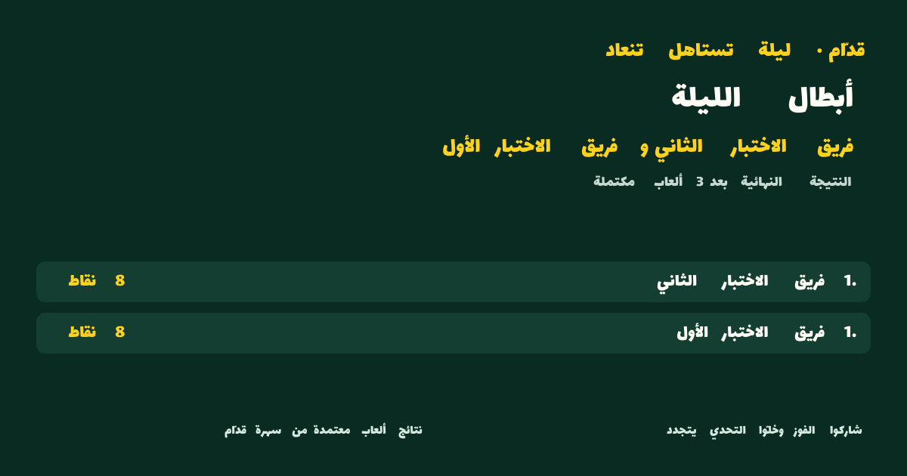

# المرحلة الرابعة: التحقق من الدعوات والحضور والتصويت والهايلايتس وبطاقة المشاركة

**PASS لبوابة المرحلة الرابعة المحلية فقط، بعد التصحيحات والمراجعة البصرية.** يبقى PR #12 مسودة وغير مدموج. النتيجة ليست موافقة إطلاق أو دمج؛ صلاحية نتائج الرأس النهائي مشروطة بتصريح الأدلة المرتبط به أدناه.

## هوية المصدر وحدود الإثبات

- المستودع: `7assan-0/quddam`.
- الطلب المستهدف: [Draft PR #12](https://github.com/7assan-0/quddam/pull/12)، الفرع `feature/night-invites-highlights-card`.
- HEAD الذي جُلب وفُحص عند البداية: `ee18ff43ef8c4e7d14ea8ddb7781c7df3f6cf69a`.
- الأساس الذي جُلب عند البداية: `feature/night-of-quddam-foundation`، عند `90c98d376d9b727ca704c3e7da91b96e600f2de1` في PR #10. هذا مرجع الأساس فقط؛ نجاحه السابق لا يثبت إضافات PR #12.
- **هوية SHA النهائي:** تُسجل حرفيًا في [تصريح الأدلة الخاص بهذه المهمة](https://github.com/7assan-0/quddam/pull/12#issuecomment-6201672382) بعد الالتزام، مع جرد المصدر ونتائج التشغيل الجديدة عليه. الرأس الذي يحتوي هذا التقرير هو مرشح مستقل؛ لا يرث نجاح PR #10 أو RC أو أي رأس أقدم. استخدام تصريح خارجي يتجنب ادعاء أن ملفًا داخل الالتزام يستطيع تضمين بصمة الالتزام الذي يحتويه.
- النتائج الموسومة «تشخيصية» نُفذت أثناء تعديلات غير ملتزم بها. أعيد التشغيل على مصدر نظيف عند `198a1ab16c6678bfcf17cb8c4b45c359f8941757` بعد آخر تعديل تطبيقي، مع تطابق جرد Git الحرفي قبل التشغيل وبعده. يضاف إلى ذلك تشغيل جديد كامل على الرأس النهائي بعد إكمال التوثيق؛ نتائجه الحرفية في تصريح الأدلة، ولا يعاد استعمال نتيجة الرأس السابق بوصفها تشغيلًا للرأس الجديد.

العمل محصور بفرع PR #12. لا دمج لـ PR #8 أو #9 أو #10 أو #12، ولا تعديل لـ main، ولا نشر عام أو دفع حي أو بريد أو WhatsApp API أو موارد سحابية جديدة. ميزة `ENABLE_NIGHT_OF_QUDDAM` معطلة افتراضيًا، وتُفعّل فقط لعملية الاختبار الاصطناعية المحلية. التكلفة الخارجية الجديدة: **$0**.

## العيوب المكتشفة والتصحيحات

| المشكلة المثبتة | أثرها | التصحيح أو الحالة الحالية | دليل الرجوع |
| --- | --- | --- | --- |
| فشل Lint عند استدعاء `setTimezone` مباشرة داخل effect في واجهة المنظّم | فحص الجودة المطلوب يفشل | أزيل تحديث الحالة المتزامن من effect؛ نجاح Lint التشخيصي اللاحق لا يغني عن إعادة الفحص النهائي | فشل Lint الابتدائي، ثم خروج Lint التشخيصي برمز 0 |
| تقييم موعد إنشاء الدعوة قبل انتظار قفل Night | قد يصبح الموعد خارج نافذة القبول أثناء الانتظار | تحقق الموعد داخل المعاملة بعد اكتساب القفل | اختبارات الخدمة والقفل؛ فحص RSVP بعد القفل كان موجودًا وحُفظ واختُبر، وليس عيبًا جديدًا أُصلح |
| إعادة الطلب المطابق كانت تعيد كتابة الرد وتستهلك عداد التغييرات | قد تُمنع استعادة نتيجة ملتزمة عند بلوغ الميزانية | أصبحت الإعادة المطابقة تأكيدًا للقراءة فقط بعد فحوص الإغلاق والصلاحية والاسم والتصويت؛ إصدار Cookie قبل POST وتخزين بصمتها سلوكان سابقان حُفظا | PostgreSQL حقيقي، وChrome مع إسقاط الرد الحقيقي بعد التزام الخادم |
| تطبيع الأسماء والمدخلات غير المكتمل | أسماء توافقية متكافئة أو key يتجاوز حد PostgreSQL أو surrogate منفرد قد تُرفض متأخرًا أو لا تتطابق | NFKC، رفض المحارف غير الصالحة، وفحص طول key بعد lowercase؛ schema صارمة أيضًا داخل الخدمة | اختبارات دعوة رجعية، ورفض alias متكرر في PostgreSQL |
| قبول جسم POST غير صالح قبل قراءة الدعوة | طلب زائد الحجم أو حقول زائدة قد يصل إلى التخزين قبل الرفض | parsing مقيد 4096 بايت والتحقق من الرمز قبل lookup؛ Cookie مقيدة بمسار الدعوة | اختبارات HTTP للحجم والحقول وCookie والصلاحيات |
| بقاء الاسم والاختيارات قابلة للتغيير بعد نتيجة شبكة ملتبسة | المستخدم قد يعيد الإرسال باسم مختلف فيُرفض الرد بـ409 رغم أن الأول حُفظ | تجميد الطلب الملتبس وإعادة إرساله بالاسم والاختيارات نفسها حتى معرفة النتيجة | قبل التصحيح: `REPRODUCED`؛ بعده: retry 200 وحاضر واحد |
| تكرار قراءة bootstrap في StrictMode قد ينشئ Cookie أولية متنافسة | أول رد قد يرتبط باعتماد مختلف عما يحتفظ به المتصفح | مشاركة قراءة bootstrap الأولى، وتوحيد صيغة الرمز وقيمة Cookie ومسارها | رُصدت قراءتان قبل التصحيح، وقراءة واحدة في تجربة الاسترجاع المصححة |
| تطبيع `Date` التلقائي لفجوة DST أو اختيار إحدى لحظتين في وقت مكرر، وقبول أوقات تقويمية غير حقيقية | موعد الدعوة قد لا يطابق اختيار المنظّم | تحويل صريح باستخدام منطقة IANA، ورفض فجوة/تكرار DST والتواريخ غير الصالحة | 10 اختبارات لتحويل الموعد؛ Chrome فعلي في Asia/Riyadh مع خادم UTC أكد اللحظة والمنطقة دون أخطاء hydration |
| تحميل ImageResponse التلقائي لصور emoji أو خطوط بعيدة عند رمز اسم غير مدعوم محليًا | طلب خارجي قد يحمل جزءًا من اسم الفريق | خط محلي معلوم البصمة؛ تمثيل Unicode قابل للتمييز للمحارف غير المدعومة، داخل البطاقة فقط؛ الاسم المخزن لا يتغير | إعادة إنتاج مستقلة اعترضت محاولات التحميل ومنعتها، ثم اختبارات الخط والمحارف |
| layout غير مدعوم في Satori وفشل توليد الصورة غير المتزامن خارج error boundary | استجابة PNG مكسورة بدل خطأ منقح | إصلاح layout وإكمال التصيير داخل معالج الخطأ قبل إرسال الاستجابة | اختبارات مسار البطاقة للأخطاء والترويسات، وتصوير PNG حقيقي |
| عنوان مفرد عند وجود بطلين متعادلين، وصعوبة عرض الأسماء الطويلة | بطاقة لا تطابق التعادل أو تعرض المحتوى بصورة غير مقروءة | صيغة الجمع عند التعادل وأحجام مناسبة للأسماء الطويلة | اختبارات البطاقة والتعادل؛ رُوجعت صورتا الفوز والتعادل بصريًا |
| ترتيب كلمات عربية معكوس في PNG رغم اتصال الحروف | البطاقة غير مقبولة بصريًا | فصل الكلمات العربية إلى مسارات flex بترتيب RTL صريح، مع إبقاء الكلمات اللاتينية المتصلة في ترتيبها؛ أعيد بناء الخادم ومراجعة الصورتين بنجاح | صورتان منقحتان مرفقتان أدناه، واختبارات ترتيب الكلمات وتصوير PNG حقيقي |

فُحص أيضًا اختلاف منطقة المتصفح عن الخادم بدل افتراض وجود عيب: Chrome في `Asia/Riyadh` مع خادم UTC سجل صفر أخطاء hydration/صفحة، وأرسل الموعد المتوقع والمنطقة الصحيحة. لا يوجد DOM للمنطقة أثناء SSR قبل اكتمال قراءة الدعوة؛ لم يتطلب هذا الفحص تعديل التطبيق. تظل أي مشكلة جديدة يكتشفها التشغيل النهائي مانعًا لحكم PASS حتى تُصحح وتُعاد اختبارات الرجوع ذات الصلة والمجموعة النهائية. لا يُخفف شرط الخصوصية أو الصلاحيات لجعل أداة الاختبار تمر.

## البيئة والتنفيذ الفعلي

نسخة مستقلة تحت `/workspace/quddam-night-phase4`، Node **24.19.0**، npm **11.9.0**، Next **16.3.6**، ومتصفح **Google Chrome for Testing 155.0.8059.79**. كل الحسابات والأسماء والمحتوى اصطناعية. المتصفح headless داخل الحاوية؛ عند استخدام `--no-sandbox` فهذا قيد حاوية الاختبار، وليس تغييرًا في أمان التطبيق أو تجاوز TLS.

أُنشئت حاوية PostgreSQL **17.11** جديدة، بصورة رسمية ذات digest:

`sha256:2d2b8998d31037bf721cfdf764d76ba74171b4fab3431b7f72c27c56ddbdf9e3`

الاستماع خاص بـ `127.0.0.1:56544`، وقاعدة البيانات الاصطناعية جديدة وفارغة قبل Migration. جرى التحقق من `current_database()` ونسخة الخادم وصفر جداول تطبيق في البداية. حُفظت الاعتمادات خارج المستودع بصلاحية 0600؛ لم تُنشر قيمها. لم تُستخدم قاعدة PR #10 أو قواعد المراجعات المالية السابقة.

| الفحص | التنفيذ المثبت | النتيجة | هل يثبت الالتزام النهائي؟ |
| --- | --- | --- | --- |
| `npm ci` | النسخة الجديدة، تثبيت مقفل | PASS، خروج 0، 11.550 ثانية | لا؛ يلزم تأكيد النسخة النهائية |
| `npm run db:generate` | النسخة الجديدة، URL اصطناعي loopback غير قابل للاتصال | PASS، خروج 0، 1.759 ثانية | لا |
| `npm run db:migrate` | القاعدة الجديدة المعزولة فقط | PASS، خروج 0، 1.279 ثانية | Migration الجديد يحتاج تأكيد عدم تغيره في الالتزام النهائي |
| ملفات Vitest الخمسة المطلوبة أولًا | قبل التصحيحات | **28 ناجحًا، 0 فشل** | لا |
| المجموعة الكاملة الابتدائية | قبل التصحيحات | **1,358 ناجحًا، 0 فشل**، 79 ملفًا | لا |
| TypeScript الابتدائي | قبل التصحيحات | PASS | لا |
| Lint الابتدائي | قبل التصحيحات | FAIL: خطأ واحد وwarning سابق واحد | لا |
| Build الابتدائي | قبل التصحيحات | **INCOMPLETE**؛ انقطع اتصال المنفذ بعد compilation دون receipt للخروج | لا؛ لا يُستنتج نجاحه من compilation |
| المجموعة الموسعة التشخيصية | بعد مجموعة من التصحيحات | **78 ناجحًا، 0 فشل** | لا؛ المصدر كان dirty |
| المجموعة الكاملة التشخيصية | بعد مجموعة من التصحيحات | **1,408 ناجحًا، 0 فشل** | لا؛ المصدر كان dirty |
| TypeScript / Lint / Build التشخيصية | بعد مجموعة من التصحيحات | PASS جميعًا، مخارج 0؛ Lint بلا أخطاء مع warning سابق | لا؛ يلزم الإعادة بعد آخر تصحيح |
| PostgreSQL تشخيصي مصحح | خدمات فعلية، دون mocks لنتائج الألعاب | **18 سيناريو ناجحًا، 0 فشل** | لا؛ المصدر كان dirty |
| Chrome الرحلة الكاملة التشخيصية | HTTP فعلي، ثلاث ألعاب أصلية | **52 تحققًا ناجحًا، 0 فشل assertions** | لا؛ التصحيح البصري الأخير لم يكن مغلقًا |
| مصدر نظيف بعد آخر تعديل تطبيقي | `198a1ab16c6678bfcf17cb8c4b45c359f8941757` | **1,410/1,410**، 83 ملفًا؛ الملفات الخمسة المطلوبة **48/48**؛ Lint خروج 0 | لا يثبت أي رأس أحدث وحده |
| PostgreSQL على المصدر المثبت | معاملات فعلية وقياس انتظار الأقفال | **18/18** | تعاد على الرأس النهائي |
| Chrome على المصدر المثبت | رحلة كاملة دون mocks | **54/54** | تعاد على الرأس النهائي |
| إعادة تشغيل الخادم المبني وتعطيل الميزة | ثلاثة processes مملوكة للاختبار | **18/18**، 3 توقفات سليمة، صفر إجبارية | تعاد على الرأس النهائي |
| الرأس النهائي بعد إكمال التقرير | تثبيت نظيف وفحوص كاملة وجرد قبل/بعد | النتائج وSHA وCI الحرفية في تصريح الأدلة | لا يعتمد PASS النهائي إلا على تطابقها |

انقطاع المنفذ الابتدائي لا يثبت سببًا مثل نفاد الذاكرة؛ السبب غير مؤكد. بعد الاستعادة شُغلت الفحوص على نحو متسلسل، مع `--maxWorkers=1` للاختبارات، وحُفظت حالات الخروج المستقلة. لا تُحسب المحاولة المقطوعة PASS، ولا تُخلط نتائج الفحوص التشخيصية بالنتيجة النهائية.

## PostgreSQL: الحضور والتصويت والتزامن

السيناريوهات الـ18 التشخيصية تغطي: إنشاء موعد مستقبلي دون خصم أو جلسة لعبة؛ رفض المواعيد والمناطق والحقول غير الصالحة؛ دعوة واحدة مع إنشاء متزامن؛ منع غير المالك وإخفاء الرابط بعد إنشائه؛ «جاي» والتصويت واسترجاع الرد بالـCookie؛ تكرار أول طلب بعد فقدان الرد؛ استبدال التصويت ثم «مو جاي» وإلغاء الصوت؛ تطبيع الاسم ورفض تكراره أو تغييره؛ رفض أصوات غير مدعومة وحقول host/points؛ حد 32 ردًا مع طلبات متزامنة؛ حد 60 تغييرًا محفوظًا في الدقيقة؛ كلا ترتيبي السباق مع START؛ حدود الصلاحية بعد القفل؛ عبور الصلاحية فعليًا أثناء الانتظار؛ بقاء التصويت استشاريًا ومحايدًا للرصيد؛ تعادل حقيقي مشتق من المحركات الثلاثة؛ وإنهاء مبكر بلا بطل.

| السباق التشخيصي | الاتصالات المستقلة المرصودة | انتظار القفل المرصود | النتيجة |
| --- | --- | --- | --- |
| RSVP في طابور القفل قبل START | 3 backends، منها اتصال حاجز مستقل | اتصالان ينتظران | يلتزم RSVP ثم START؛ لا تُقبل ردود لاحقة |
| START في طابور القفل قبل RSVP | 3 backends، منها اتصال حاجز مستقل | اتصالان ينتظران | يلتزم START؛ يُرفض RSVP بـ409 ولا يُضاف حاضر |

كل العمليات تتبع ترتيب قفل `NightSession` ثم `NightInvitation`، مع فحص المرحلة والصلاحية بعد القفل. حد **32** هو عدد الردود المحفوظة إجمالًا، بما فيها «مو جاي»، وليس عدد لاعبي غرفة. عند امتلاء الحد رُفضت الزيادات دون تضاعف الأصوات.

حد **60 في الدقيقة** يخص تغييرات RSVP/التصويت المقبولة والمحفوظة لكل دعوة. إعادة الطلب المطابق بعد نتيجة شبكة ملتبسة لا تنشئ تغييرًا جديدًا، لكنها تظل مرفوضة بعد إغلاق الدعوة أو انتهاء صلاحيتها. هذا الحد لا يمثل حماية شاملة من إغراق GET أو إجمالي طلبات HTTP أو هجوم موزع؛ لا يدعي التقرير ذلك.

## Chrome: الرحلة الحقيقية وبطاقة المشاركة

نُفذت الرحلة التشخيصية من الواجهات: تسجيل دخول اصطناعي، إنشاء سهرة، ضبط موعد، إنشاء رابط مرة واحدة ونسخه، فتحه بمتصفح مستقل مجهول، «جاي» والتصويت، تحديث الصفحة واسترجاع الرد، استبدال الصوت، عرض المجاميع لدى المنظّم، ثم «مو جاي» وإلغاء التصويت دون إضافة رد ثانٍ. اختبارات HTTP الجانبية للصلاحيات لا تُعرض بوصفها بديلًا عن خطوات الواجهة.

لُعبت الألعاب الأصلية من واجهاتها، لا بكتابة نتائج نهائية مباشرة في قاعدة البيانات:

| اللعبة | الجولات المنفذة | النقاط الخام التشخيصية | نتيجة الاعتماد |
| --- | --- | --- | --- |
| توب 100 | 5 | 39–36 | استيراد نتيجة محرك مكتملة |
| رتّبها | 7، مع متحكمين منفصلين للفريقين | 70–0 | استيراد نتيجة محرك مكتملة |
| قالوا الناس | 5 | 900–0 | استيراد نتيجة محرك مكتملة |

ظهرت النتيجة التراكمية **9–6** بعد الألعاب الثلاث، والهايلايتس من نتائجها المقبولة. نُزّلت PNG فعلية **1200×630** من زر الواجهة. اختُبر كذلك تعادل **8–8** ناتج عن تشغيل المحركات الأصلية في اختبار PostgreSQL، وعُرض البطلان ونُزلت بطاقتهما في Chrome. تجربة التعادل ليست ادعاء إعادة لعب سهرة تعادل ثانية بالكامل عبر الواجهات.

اختُبر الإنهاء المبكر من الواجهة: لا بطل، ولا بطاقة بطل، وملخص يصرّح بعدم الاكتمال. رفض مسار الصورة الضيف المجهول وغير المالك والسهرة غير المكتملة. اختُبرت ترويسات `private, no-store` و`no-referrer` و`noindex` على الخادم المبني، لا بافتراض أن خادم التطوير يحافظ عليها.

**بوابة المراجعة البصرية: PASS بعد التصحيح.** فشلت الصورة الأولى بسبب ترتيب الكلمات رغم اتصال الحروف. رُوجعت الصورتان التاليتان بدقة 1200×630 بعد إعادة البناء: ترتيب العربية والأسماء صحيح، ونقاط 9–6 ظاهرة، والتعادل 8–8 يعرض البطلين. ملفات PNG لا تتضمن tokens أو Cookies أو IDs أو metadata نصية خاصة. الأسماء اصطناعية.




الخط المحلي الموجود مسبقًا هو Lalezar؛ تربطه الاختبارات ببصمة SHA-256. المحارف غير المدعومة تعرض بصيغة Unicode قابلة للتمييز داخل الصورة، مع مضاعفة الأقواس الحرفية لمنع تصادم العرض؛ الاسم المخزن لا يتغير. لا تُستخدم خدمة صور أو خط/emoji خارجي. ليست هذه دعوى دعم فني كامل لكل كتابة عالمية.

المحاولة المثبتة عند `198a1ab` سجلت **0 استثناءات صفحة غير معالجة** و**0 hydration** و**0 طلبات متصفح خارجية**. رُصدت **3 console errors** بسبب طلبات سلبية مقصودة: `409` مرتين و`400` مرة. رُصدت **145 عملية إلغاء ERR_ABORTED**: 141 Next/RSC prefetch، وثلاثة event streams عند التنقل، وGET واحد لـNight؛ ليست فشلًا في اعتماد نتيجة، ولا نعرضها كصفر. إعادة التشغيل سجلت 40 إلغاءً وصفر أخطاء Console/صفحة. أعداد الرأس النهائي الفعلية تُنشر في تصريح الأدلة؛ لا تنشر URLs أو الرسائل الخام.

عولجت مشكلتان في harness دون تخفيف أمان التطبيق: Playwright Node APIRequestContext لا يرسل Secure Cookie في إعداد loopback HTTP كما يفعل Chrome؛ لذلك استُخدم fetch من المتصفح المسجل فعليًا لفحوص المالك. والمتصفح يمنع تزوير Origin يدويًا؛ نُقل اختبار Origin المعادي إلى عميل HTTP مستقل. لا يُحسب فشل أدوات الاختبار إثباتًا لفشل حساب المالك أو نجاح تجربة غير منفذة.

## الخصوصية والصلاحيات والرصيد والتخزين

- لا تُحفظ invitation bearer أو capability الخاصة بـRSVP كنص صريح في جداول الدعوات؛ يُحفظ SHA-256 لكل منهما. الرابط الخام يظهر مرة واحدة في استجابة الإنشاء للمالك؛ التحديث لا يكشفه مجددًا. لا يوجد استرجاع أو تدوير تلقائي للرابط في هذا الإصدار.
- Cookie الخاصة بـRSVP منفصلة، `HttpOnly` و`SameSite=Lax`، و`Secure` في production، ومقيدة بمسار API للدعوة. لا تمنح صلاحية المالك أو إدارة الألعاب، ولا تحل محل `qalba_session`.
- العرض العام يقتصر على الموعد والمجاميع ونتائج التصويت ورد صاحب الـCookie وحده؛ لا تنشر أسماء بقية المدعوين أو hashes أو معرفات الجلسات الداخلية.
- POST يتطلب Origin مطابقًا، والجسم مقيد بالحجم الفعلي 4096 بايت وschema صارمة. الحقول الإضافية والنتائج/الصلاحيات المصطنعة مرفوضة. أخطاء البنية التحتية لا تعكس قاعدة البيانات أو الأسرار في الرد.
- مسارات البطاقة والهايلايتس للمالك فقط. البطاقة لا تضم رابط الدعوة أو Cookies أو إجابات الألعاب أو source session IDs، ولا تُرسل تلقائيًا إلى أي خدمة.
- الـMigration الجديد `20261016010000_night_invites` إضافي لجدولي الدعوة والردود وفهارسهما. لم يُعدّل Migration ليلة قدّام السابق أو تاريخ migrations أو أدلة RC. أكد فحص Git بعد التصحيحات عدم تغيير schema أو migrations أو محركات الألعاب أو billing/payment أو ملفات RC التاريخية؛ يعاد فحص جرد الرأس النهائي.
- الدعوة والتصويت لا ينشئان غرفة P2P أو يبدآن عداد 60 دقيقة. لا تعديل لمحركات الألعاب أو أسعارها أو منطق الرصيد. جرى قياس ثلاث عمليات خصم فقط، واحدة لكل START أصلي؛ إنشاء السهرة والدعوة وRSVP وNEXT وIMPORT والهايلايتس وتنزيل البطاقة لا تضيف خصمًا. أكدت اختبارات PostgreSQL وChrome هذه الحدود على المصدر المثبت؛ تعاد على الرأس النهائي.
- التصويت استشاري؛ ترتيب الألعاب المحفوظ لا يتغير تلقائيًا. لا بيانات إنتاج أو حسابات شخصية حقيقية في الاختبار أو الأدلة المنشورة.

## الملفات ومسار إعادة الإنتاج

الملفات المصححة أو المضافة في هذه المهمة، مقارنة بـHEAD الابتدائي، وليست إعادة تعداد جميع أساس PR #12:

- `src/lib/night/invitation.ts` و`invitation-service.ts` و`invitation-http.ts`: التحقق والساعة والقفل والتكرار واعتماد RSVP.
- `src/lib/night/invitation-time.ts`: تحويل الموعد في منطقة IANA ورفض أوقات DST غير المحددة.
- `src/components/night-invitation-setup.tsx` و`night-invite-rsvp.tsx` و`src/app/night/invite/[code]/page.tsx`: تدفق المنظّم والضيف وتثبيت الطلب الملتبس وbootstrap.
- `src/app/api/night/invite/[code]/route.ts`: حفظ إصدار Cookie الأولية الموجود سابقًا، وتضييق مسارها وتوحيدها والتحقق المبكر قبل قراءة التخزين.
- `src/app/api/night/[id]/share-card/route.tsx` و`src/lib/night/card-text.ts`: التصيير المحلي وحماية المحارف وفشل الصورة. يتضمن ترتيب العربية الصريح واختبارات الرجوع.
- `src/lib/night/{invitation,invitation-time,highlights,card-text}.test.ts`، و`src/app/api/night/invitation.route.test.ts`، و`src/app/api/night/[id]/highlights/route.test.ts` و`src/app/api/night/[id]/share-card/route.test.tsx`: اختبارات الرجوع للحدود المصححة.
- `scripts/night-phase4-fixtures.ts` و`night-phase4-postgres.ts` و`night-phase4-chrome.mjs` و`night-phase4-lost-response.mjs` و`night-phase4-restart.ts`: fixtures اصطناعية واختبارات PostgreSQL وChrome وفقدان الرد.
- `docs/night-phase4-verification.md` و`docs/night-invitation-highlights-acceptance.md` و`docs/evidence/night-phase4-{champion,cochampions}.png`: الأدلة المنقحة وحدود القبول؛ جرد الملفات وبصمات المصدر يرفقان بتصريح الأدلة.

ابدأ بنسخة نظيفة من SHA النهائي، واقرأ شروط عزل scripts قبل التنفيذ. متغيرات البيئة والاعتمادات تُحمّل من ملف خاص خارج المستودع؛ لا تنسخ URL أو Cookies إلى shell history أو التقرير. لا تشغّل migrate إلا بعد التحقق من خادم PostgreSQL17 محلي جديد وفارغ:

```sh
cd qalba-platform
npm ci
npm run db:generate
# فقط بعد إثبات أن DATABASE_URL لقاعدة PostgreSQL17 جديدة ومعزولة وفارغة:
npm run db:migrate
npx vitest run src/lib/night/invitation.test.ts src/lib/night/highlights.test.ts src/app/api/night/invitation.route.test.ts src/proxy.test.ts src/components/night-of-quddam.test.tsx --reporter=verbose --maxWorkers=1
npm run test -- --maxWorkers=1 --retry=0
npm run typecheck
npm run lint
npm run build
```

بعد fixtures الاصطناعية المحددة وحفظ marker وملفاتها الخاصة، تُشغّل scripts باستخدام `NIGHT_MVP_SYNTHETIC=1`، و`NIGHT_MVP_ENV_FILE` الخاص، و`NIGHT_MVP_OUTPUT` خارج checkout، و`ENABLE_NIGHT_OF_QUDDAM=true`. يرفض harness قاعدة غير loopback أو اسمًا غير اصطناعي أو غياب marker أو الكتابة فوق evidence سابقة. اختر `NIGHT_PHASE4_RUN` جديدًا لكل محاولة:

```sh
# مرة واحدة فقط، على القاعدة الجديدة الفارغة بعد migration:
node --import tsx scripts/night-mvp-fixtures.ts --seed
node --import tsx scripts/night-phase4-fixtures.ts
# اختر اسمًا جديدًا إن كان المجلد موجودًا؛ لا تمح evidence سابقة:
NIGHT_PHASE4_RUN=phase4-postgres node --import tsx scripts/night-phase4-postgres.ts
# بعد بناء وتشغيل Next على loopback مع البيئة الاصطناعية فقط:
NIGHT_PHASE4_NATIVE_RUN=phase4-postgres node scripts/night-phase4-chrome.mjs
node scripts/night-phase4-lost-response.mjs
# بعد إيقاف الخادم الذي أنشأه المختبر فقط وتعيين NIGHT_MVP_JOURNEY_FILE:
node --import tsx scripts/night-phase4-restart.ts
```

عند إعادة الاختبار على نفس القاعدة المملوكة للاختبار لا تعِد seed؛ استخدم marker والملفات الخاصة الموجودة بعد إثبات هويتها، واختَر مجلدات run جديدة. `NIGHT_MVP_JOURNEY_FILE` يشير إلى `journey.private.json` الذي أنتجه Chrome، وبجواره ملفا الدعوة والـCookies الخاصان. script إعادة التشغيل يرفض منفذًا مشغولًا ومصدرًا لا يطابق Git الحرفي.

حدد `BASE_URL` loopback و`CHROME_EXECUTABLE` لمتصفح Google Chrome الحقيقي المتحقق منه. احتفظ بمخرجات الدخول والرموز والإجابات والتشخيص الخام خارج التقرير؛ انشر receipt منقحة وصور لوحة/بطاقة لا تكشفها. نجاح هذا الخادم المحلي المبني لا يثبت launcher الإنتاج أو HTTPS أو النشر العام.

## الاختبارات غير المنفذة والمخاطر المتبقية

| المجال | الحالة وحدود الادعاء |
| --- | --- |
| إعادة التشغيل الكاملة على الرأس النهائي | تصريح الأدلة يسجل SHA الحرفي والجرد ونتائج الإعادة؛ لا يكفي أي تشغيل أقدم |
| PNG عربي مصحح ومراجع بصريًا ومرفق | PASS محليًا؛ الصورتان أعلاه، وإعادة التنزيل على الرأس النهائي في الأدلة |
| تطابق مناطق الزمن/hydration بين خادم UTC ومتصفح غير UTC | PASS تشخيصي في Chrome Asia/Riyadh: الموعد والمنطقة مطابقان، صفر أخطاء؛ وتشمل رحلة Chrome النهائية المنطقة نفسها |
| إغلاق الميزة وإعادة تشغيل الخادم وفحص كل إضافات المرحلة الرابعة | PASS: 18 تحققًا فعليًا، 13 طلب GET/POST معطلًا كلها 404، حفظ الرد والنتائج والرصيد بين التشغيلات |
| CI مستضاف لالتزام التصحيح النهائي | يسجل رابطه ونتيجته الفعلية في تصريح الأدلة؛ workflow المالي وحده لا يختبر رحلة Night في Chrome أو PG17 |
| LAN وجهازان فعليان وشبكات مختلفة وNAT | NOT RUN؛ النطاق محلي loopback ولا يحتوي دمج P2P |
| HTTPS وlauncher الإنتاج والنشر العام | NOT RUN؛ لا موافقة نشر ضمن المهمة |
| بريد أو WhatsApp API أو دفع حي أو موارد خارجية | NOT RUN عمدًا ومحظور ضمن النطاق |

حامل الرابط يستطيع إعادة مشاركته. الاسم المستعار ليس هوية شخصية موثقة، ومسح Cookies أو استخدام متصفحات جديدة يسمح بمحاولات بأسماء مختلفة داخل الحدود؛ لا يوجد ادعاء مقاومة كاملة للتلاعب أو حماية DDoS. إصلاح StrictMode يخص bootstrap في المكوّن نفسه؛ نوافذ أولى مستقلة ومتزامنة قد تتنافس على Cookie قبل استقرارها، ولا يُعرض ذلك كإثبات هوية. لا تكفي بصمات الروابط لإلغاء أثر رابط سبق تسريبه. إذا التزم إنشاء الدعوة وفُقد رد الشبكة الأول قبل حفظ الرابط، يعرف المالك بوجود الدعوة بعد التحديث لكن لا يمكنه استرداد الرمز الخام؛ تدويرها أو إلغاؤها يحتاج القرار والتنفيذ المنفصلين المحجوزين للمالك. هذه حدود صريحة وليست عيوبًا عولجت بتحايل أو توسعة صلاحيات.

**قرارات وإجراءات إطلاق منفصلة لم تُنفذ:** حذف/تصدير/مدة الاحتفاظ بردود الضيوف، إزالة الردود وسجلها، إلغاء/تدوير الدعوات، حماية إساءة الاستخدام الفعلية، الإشعارات المصرح بها، وتصحيح النتائج بعد اعتمادها. لا آلية حذف أو تدوير خفية، ولا تشغيل بريد أو خدمات جديدة. بوابات الإطلاق المالية والتشغيلية السابقة، ومنها معالجة PENDING hold المعتمدة والمراقبة والتنبيه والتحقق التجاري وبوابات الإصدار اللاحق، لا تزال خارج إثبات هذه المهمة.

## القرار وحدود القبول

**PASS لبوابة المرحلة الرابعة المحلية** متى أكد تصريح الأدلة إعادة الفحوص على SHA النهائي وتطابق المصدر قبلها وبعدها. رحلة الدعوة ← RSVP ← التصويت ← الألعاب الأصلية الثلاث ← اعتماد النتائج ← الهايلايتس ← تنزيل بطاقة عربية صحيحة نجحت فعلًا، مع اختبار فقدان الرد والتزامن والصلاحيات وإعادة التشغيل والتعطيل. يبقى PR #12 Draft وغير مدموج حتى مراجعة المالك وموافقته. لا تعني هذه النتيجة المحلية جاهزية الإنتاج أو اجتياز بوابات الإطلاق الأخرى.

## سجل المحاولات والإخفاقات المنقحة

لم تُمح المحاولات الفاشلة: Lint الأصلي فشل، ومحاولة Build الأولى بقيت INCOMPLETE. فشل إعداد native أول مرة لأن ساعة السيناريو سبقت إنشاء صف ميزانية الطلبات؛ صُحح إعداد الاختبار دون تغيير سياسة العمل. فشل Build لاحقًا بسبب أنواع سكربت restart الجديد؛ صُححت الأنواع ثم نجح typecheck وBuild. فشل تحقق no-store على خادم Next dev لأنه يستبدل Cache-Control؛ جرى الاختبار على `next start --hostname 127.0.0.1 --port 3000` المبني محليًا، دون تعديل node_modules أو تعطيل الحماية. لم يحدث رفض سياسة لتشغيل next start ولم يُستخدم التفاف عليه. لا يثبت ذلك launcher الإنتاج أو HTTPS.

أُغلقت أربع سهرات تخطيط اصطناعية عبر أمر END الرسمي بعد ظهور روابطها عرضًا أثناء التشخيص المحلي، بلا خصم وبلا workaround لقاعدة البيانات. لم تكن بيانات حقيقية، ولا تتضمن الأدلة المنشورة تلك الروابط أو السجلات الخام. بقية مواد الاعتماد الخاصة محفوظة خارج Git بصلاحيات خاصة.
