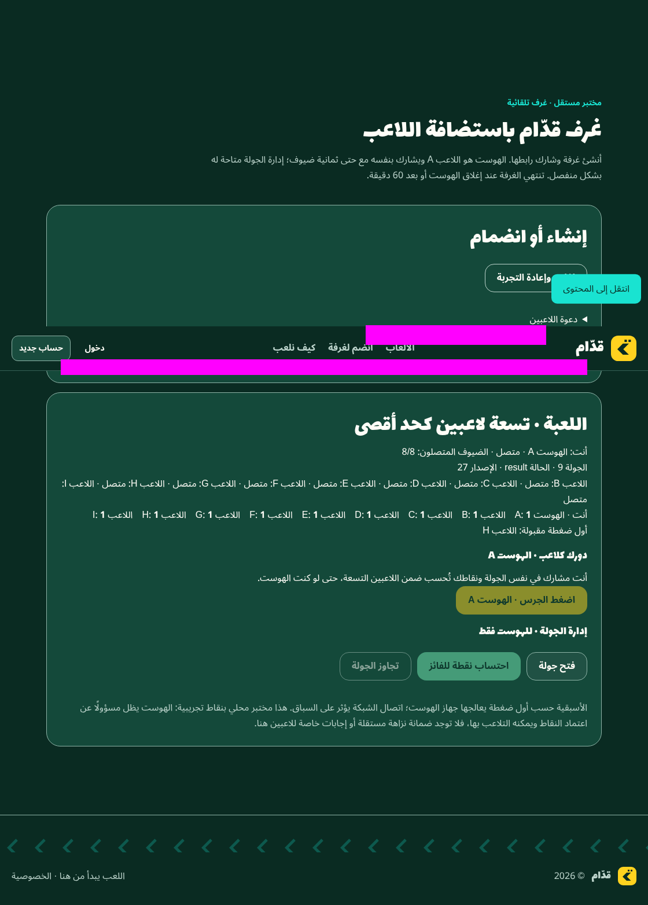

# Nine-player automatic-room verification

Scope: draft [PR #9](https://github.com/7assan-0/quddam/pull/9), stacked on unmerged draft PR #8. The initial remote head inspected was `81ba0385dacf9fcc336bde4032af2f579c26da03`; base was `1a944902b9b11846e69667a2a1f6d9a8166d3204`. Neither this report nor a local test approves merging or deployment. Original games, payments, branding/accessibility and historical release evidence are preserved.

## Confirmed defect and correction

Signaling already enforced creation + 3,600,000 ms, but the controller previously waited for a poll failure. Live data channels could accept buzzes, awards or snapshots after the deadline while polling was delayed. An independent deadline timer now closes links and cancels timers/in-flight work. Gameplay, received messages, async signaling continuations and retries also check the original expiry synchronously, including when browser timers are throttled. Retry identity and expiry must remain unchanged; no sliding renewal is introduced.

Independent adversarial review also reproduced deadline crossings *inside* connection refresh, activation and guest snapshot handling. These could publish a nonterminal view after closure, access cleared credentials, or accept a late snapshot. The correction keeps closure terminal and rechecks after nested helpers before using credentials or mutating state.

Development evidence is deliberately separated:

- Original-controller regression stage: **12 failed / 17 passed**, before the first fix; [sanitized extract](evidence/player-hosted-nine/expiry-original-red.txt).
- Additional race-regression stage: **4 failed / 36 passed**, before the nested-callback correction; [sanitized extract](evidence/player-hosted-nine/expiry-races-red.txt).
- Corrected controller development run: **40 passed / 0 failed**. This is scoped controller coverage, not the complete release suite.
- [Native Chrome preflight](evidence/player-hosted-nine/preflight.json): **51 successful assertions across 39 state checkpoints**, including nine simultaneous native players, A scoring, every score reaching every participant, overflow rejection, bounded stale/malformed/identity-added packet rejection, I resuming, guest departure, host closure, new-room zeros and the separate synthetic browser-clock boundary. The JSON distinguishes 51 assertions from its state checkpoints.

The preflight identifies modified working-tree bytes, their SHA-256 hashes and browser identity. Its predecessor Git HEAD is **not** claimed as a verified committed candidate. The frozen-head rerun receipts attached to PR #9 identify the exact tested head, literal committed-byte/mode comparison, complete discovered unit inventory, command exit codes, browser checkpoints, resource samples and any real-time soak. Those receipts, rather than a predecessor or historical RC result, determine the final scoped recommendation.




## Reproduce with synthetic local data

Use an isolated checkout of the exact PR head. Do not load production dotenv files, merchant credentials or customer data. Set `DATABASE_URL` to an intentionally unreachable synthetic loopback database; Prisma generation needs no database connection or migration. Disable telemetry. Then, under `qalba-platform`:

```sh
npm ci
npm run db:generate
npm run typecheck
npx vitest run src/lib/player-hosted --reporter=verbose
npm run lint
npm run build
```

The development environment uses Node 24.19.0, npm 11.9.0 and locked Playwright 1.56.1. Prisma generation must precede typechecking; a check run before generation reported missing generated client declarations and was not counted as a pass. Next can regenerate `next-env.d.ts` imports for dev/build output; verify that only the `.next/dev/types/` versus `.next/types/` import paths changed and restore that generated-only difference before attesting a clean committed tree.

Start the already-approved **loopback development** configuration in a separate terminal:

```sh
ENABLE_PLAYER_HOSTED_ROOMS=true \
PLAYER_HOSTED_SIGNALING_ORIGIN=http://localhost:3000 \
NEXT_TELEMETRY_DISABLED=1 \
node node_modules/next/dist/bin/next dev --hostname 127.0.0.1 --port 3000
```

Use a real Google Chrome executable (the runner rejects a differently branded executable). The exercised distribution is official Google Chrome for Testing 155.0.8059.79, headless. Playwright launches it with the container sandbox disabled; this is an isolated synthetic test configuration, not a production-browser hardening recommendation.

```sh
CHROME_EXECUTABLE=/absolute/path/to/google-chrome \
BASE_URL=http://localhost:3000 \
node scripts/player-hosted-nine-chrome.mjs \
  --evidence-dir /absolute/private/path/outside-the-checkout \
  --clock-boundary
```

The runner uses separate storage contexts and native RTC connections, alternating invitation-link and typed-code joins. It observes native RTC objects; it does not simulate SDP, ICE, channels or peer connectivity. It checks all nine players scoring once (round 9 / version 27), duplicate awards/buzzes, late host UI attempts, seat-preserving reload, departures, fresh browser contexts and same-page reset. The direct controller tests separately prove that calling the host's `buzz()` cannot overtake an already accepted guest; clicking a disabled UI control alone is not that proof.

To add the optional real-hour room lifecycle, append `--soakMinutes 60`. Keep source/HEAD fixed throughout. This separate case uses actual monotonic elapsed time and native links, not the browser test clock. It records creation/setup time, heartbeats, connected counts and expiry. Because joining takes time after creation, it must not be described as nine players connected for a full 60 minutes. The authoritative store/controller unit boundaries and synthetic browser expiry case are separate evidence from this real-time run.

## Evidence and limitations

The runner emits allowlisted JSON, status/failure counts and invitation-masked screenshots. It writes no invitation values, capability tokens, SDP, ICE candidates, traces, video or network dumps. Source start/end inventories and a separate runner hash detect runtime-source changes during execution; an exact-head attestation additionally compares tracked working-tree bytes/modes directly with the literal Git commit, with Git replacement objects disabled.

CPU samples are actual CDP `ThreadTime`/`ProcessTime` deltas relative to monotonic elapsed time, expressed as a percentage of one CPU core. The scope is the host page/renderer, which may share a process; it is not total machine or whole-browser CPU. Memory samples are host JavaScript heap bytes, not total browser RSS. Idle eight-link and gameplay/reconnection intervals are labeled separately. Console counts include expected rejected admission responses and canceled requests during reload/closure; the final runner records sanitized error/status categories rather than assuming every count is an application exception.

The first clean setup/typecheck/unit/lint/build preflight exited zero; Lint reported one pre-existing unused-variable warning in `scripts/staging-arm64-pg17-ci.mjs`. `npm audit` on the unchanged lockfile reported 14 advisories (3 moderate, 10 high, 1 critical, including development tooling). This observation is not an exploitability assessment. Dependency remediation is a separate reviewed task; no lockfile upgrade is hidden in the room correction.

- **LAN: NOT RUN.** Two physical devices are unavailable. A future approved plan must specify device/browser inventory, exact private listener/origin, HTTPS and certificate requirements, and any firewall/trust-store changes. Stop for owner approval before making those changes; the current loopback-only signaling gate must not be silently relaxed.
- **Different networks / NAT / STUN / TURN: NOT RUN.** No ICE servers or public signaling were added. A single-host test proves no Internet connectivity claim.
- **Production runtime (`next start`): NOT RUN.** Production build success is recorded separately from development-server execution. No execution-policy refusal was bypassed.
- Browser suspension, clock skew, process restarts and real-device networking remain operational validation topics. Signaling is in-memory and single-process; host departure terminates authority rather than migrating it.
- The host is the score authority, not a neutral competitive referee. Independent competitive fairness remains a separate design requirement.
- No deployment, external infrastructure, payment/email activation or new paid service occurred. New external-service spending: **$0**. Keep PR #9 draft and unmerged pending owner review.
