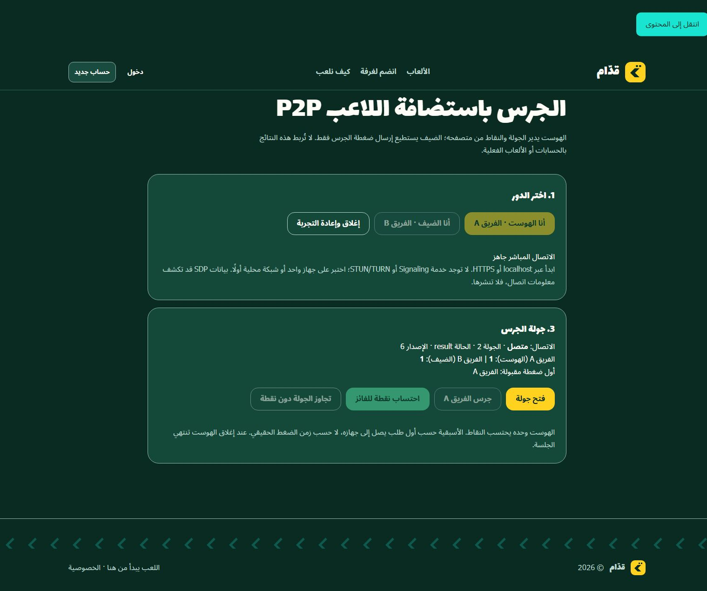
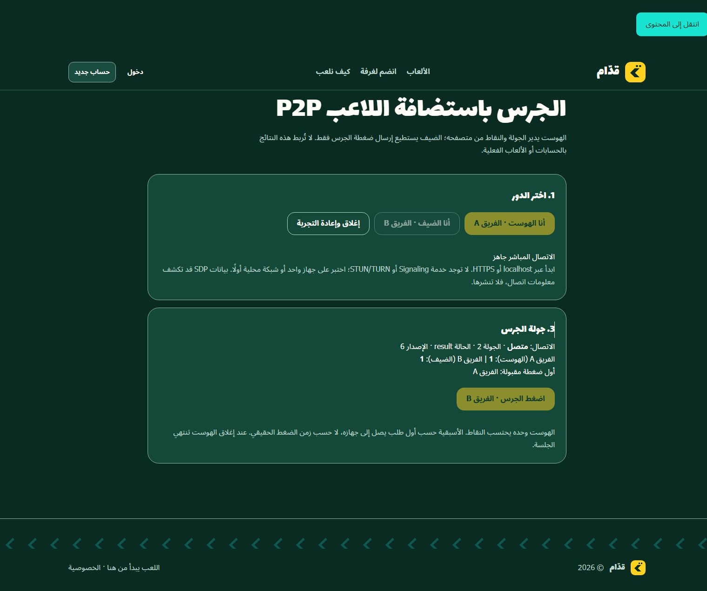

# Player-hosted PoC implementation and acceptance results

Result: **PARTIAL overall; native loopback WebRTC PASS**. Verification performed 15 October 2026 Riyadh time (14 October UTC) on the existing Windows/Chrome computer. Baseline: PR #8 branch `experiment/player-hosted-webrtc-poc`, commit `001211d367ada1b744088e201e41e5c5f6d99214` on top of merged PR #5. No merge or deployment is authorized by these results.

## Implementation fixes

- Replaced mutable cross-session component callbacks with one disposable `LabSession` per pairing. Reset/unmount/pagehide cancel ICE waits, remove listeners, clear timers and close channels/peers; late promises/callbacks cannot update a replacement session.
- Terminal SDP/ICE/connection failures release resources and end the attempt. Malformed JSON can be corrected before a peer is created. ICE gathering is limited to15 seconds, and the post-answer pairing deadline is120 seconds to allow manual copy/paste. No automatic reconnect or retry loop was added.
- Both local host actions and incoming guest intents require a live connected peer/channel. The guest controller cannot issue host actions; its wire parser accepts only a bounded current-round BUZZ. One winner and one host award per round remain enforced.
- Equal-version replacement, old snapshots, round/score rollback, coerced phases and impossible score/round/version combinations are rejected. The UI displays the accepted state version and disables new rounds at100.
- Send/backpressure failures and unexpected additional/unreliable channels close or reject the relevant channel safely. SDP fields are cleared after connection or session end.
- A real browser test found that the disconnected screen still said the buzzer was open. It now explicitly says the buzzer is closed without a direct connection, while retained historical state remains unplayable.

No dependency or lockfile changes, game-engine changes, billing changes, database migrations, room/SSE changes, STUN/TURN server or public signaling service were added.

## Local command results

| Check | Result |
| --- | --- |
| `npm ci` | PASS;598 packages installed from the existing lockfile |
| `npm run db:generate` | PASS; necessary local Prisma client generation, no DB connection/migration |
| `npm run typecheck` | PASS |
| `npx vitest run src/lib/player-hosted/lab.test.ts src/lib/player-hosted/session.test.ts` | PASS;18 tests across2 files |
| `npm run lint` | PASS;0 errors; one unchanged `baseline` unused-variable warning in `scripts/staging-arm64-pg17-ci.mjs:62` |
| `npm run build` | PASS; optimized Next16.3.6 build including `/labs/player-hosted` |
| Flag OFF on the built app | PASS; Not Found UI, no role buttons or SDP fields |
| Cleanup | Test pages/windows and loopback listeners3000/3001/3002 closed/stopped |

Checks were repeated only after the lifecycle/UI/timeout fixes. npm reported14 pre-existing dependency audit findings (3 moderate,10 high,1 critical); the lockfile is unchanged and no broad audit-fix upgrade was performed. This is not a production dependency-security sign-off.

The flag-OFF HTTP response was200 because the existing root layout streams its Not Found response. This behavior is documented by the installed Next16.3.6 `not-found` guide. Chrome showed the application's404 UI and no lab controls. We do not misreport this as an HTTP404 test, and did not change global routing/proxy behavior just to alter that status.

## Native browser acceptance

The tested application used real browser `RTCPeerConnection` and ordered DataChannel instances with `iceServers: []`. Offer/Answer were read from the UI and pasted only into the intended local peer. No RTC mocks were injected into the browser, and no SDP, ICE credentials or private candidate addresses were saved in public evidence.

The completed tests used **two independent tabs on one Chrome device**. Two independent popup windows were also opened, but browser automation could read them while native input/capture timed out, including an explicit-focus attempt. That strict two-window test is **blocked**, not passed. Keyboard input was not a reliable substitute. The fallback tabs are not described as two physical devices or two different networks.

| Acceptance case | Actual result |
| --- | --- |
| Offer/Answer/ICE and both peers connected | PASS; connected, round0, version0, scores0–0 |
| Host opens round1 | PASS; both open/version1 |
| Guest buzz wins | PASS; both locked toB/version2; host buzzer disabled |
| Host-only award | PASS; B receives one point/version3; guest has no award controls; repeat award disabled |
| Next round clears prior winner | PASS; round2 open/version4, prior scores preserved |
| Host buzz wins | PASS; both locked toA/version5; guest buzzer disabled |
| Second result synchronization | PASS; both round2/result/version6/scores1–1 |
| Host reset during an open round | PASS; native channel ends remotely, guest buzz disabled, host temporary state cleared |
| Rapid start/reset and a fresh pairing | PASS; no old SDP/state resurrected; reconnected at round0/version0/scores0–0 |
| Closing the host page | PASS; guest channel ended and buzzer disabled |
| Final session cleanup | PASS; state/signaling cleared; test pages and local servers stopped |
| Two physical LAN devices | NOT RUN |
| Different networks/NATs | NOT RUN |

Malformed/stale/duplicate wire packets and cancellation races are regression-tested with lifecycle doubles in Vitest. Those assertions are distinct from the native browser UI acceptance and are not claimed as a real-browser hostile-packet fuzzing run. The session remains host-authoritative, first-arrival wins, and a dishonest host can cheat. There is no player identity, persistence or host migration.

## Evidence

The structured [browser results](evidence/player-hosted/browser-results.json) contain UTC timestamps and sanitized UI state. After round2 the signaling fields were absent on both peers:

## Remaining gate

1. Complete the strict two-window acceptance with a controllable browser window arrangement or owner assistance. The earlier popup input failure is a tooling limit, not proof of a WebRTC failure.
2. Perform a separate two-device LAN test with a trusted secure origin and deliberate network access. No device trust, firewall, hosts or LAN listener configuration was changed here.
3. For reliable different-network operation, separately review authenticated signaling, secure origins, NAT discovery/STUN and a TURN relay fallback, bandwidth/cost limits and abuse handling. No paid or public service is assumed or created. Direct connectivity on this computer proves none of these network paths.

The PR stays draft and unmerged. The existing OCI staging NO-GO and financial gate are unchanged.
