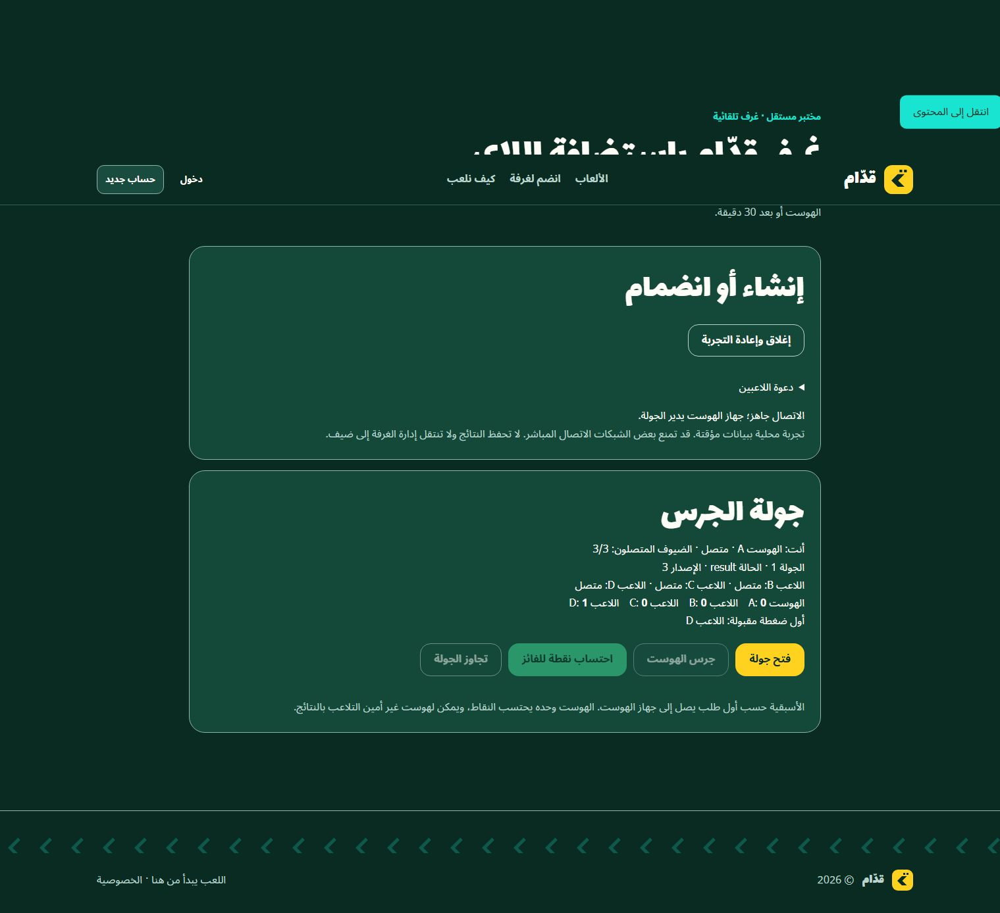
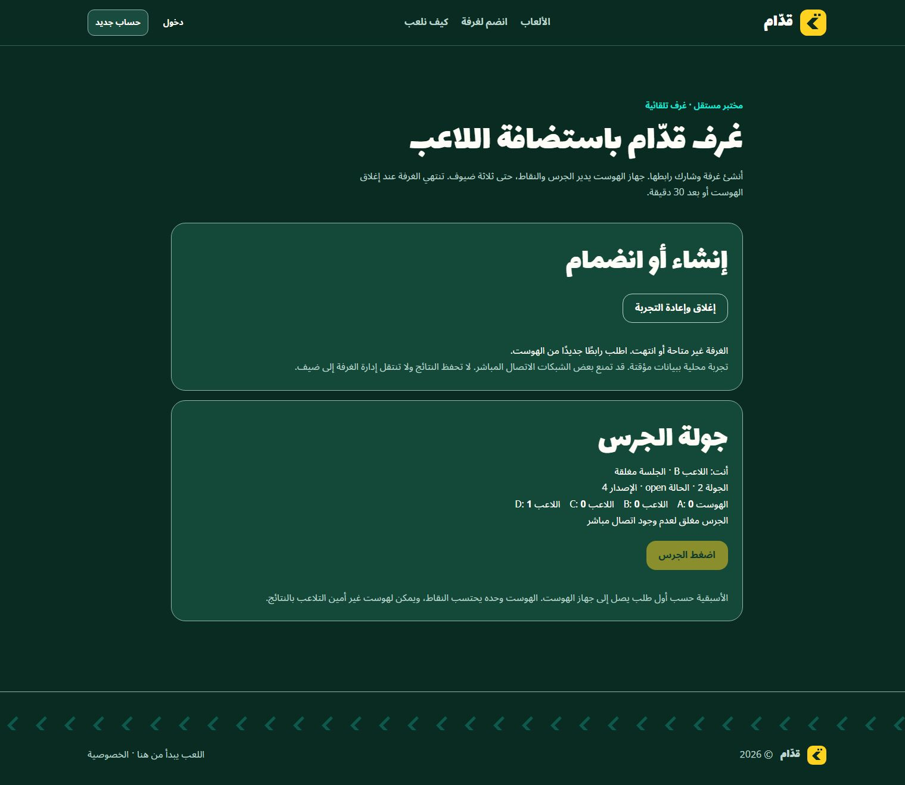

# Phase 2 verification — automatic player-hosted rooms

**PARTIAL overall; local automatic rooms PASS.** Verified 15 October 2026 Riyadh time (14 October UTC), building on PR #8 head `1a944902b9b11846e69667a2a1f6d9a8166d3204`. The new experimental branch is `experiment/player-hosted-auto-rooms`; its draft PR targets the PR #8 branch, preserving that PoC without merging either PR into main.

## What was implemented

- A separate gated lab with create, share link, automatic link join, code join and user-facing connection states. Host plus three fixed guest slots; a fourth guest is rejected.
- Local single-process HTTP rendezvous, random 128-bit invitations, separate 256-bit capabilities, strict direction/slot authorization, TTL/lease expiry, bounded room/rate/body/SDP limits and exact same-origin loopback enforcement.
- One host-to-guest RTC connection per guest. Offers/answers and complete ICE exchange happen automatically. No user-visible SDP, external signaling, STUN/TURN or cloud provisioning.
- A pure four-player game protocol separated from HTTP/RTC/React. Only host actions change rounds/scores; guests send bounded BUZZ intents. Snapshots are versioned and validated, and one winner/award is enforced.
- Bounded explicit reconnect, guest refresh/resume with the same slot, no host credential persistence or promotion, epoch fencing against stale pagehide/poll/signal requests, per-link failure isolation and complete cancellation/cleanup. Reset clears the invite URL fragment.
- Guards and regression tests for channel-open/peer-connected event ordering, including early snapshot arrival, and for late async completion after disposal.

No dependency/lockfile, existing engine, database, billing, original room/SSE route, certificate, hosts, firewall, OCI or account setting was changed. The previous manual PoC and all 18 of its tests remain unchanged. Existing dependencies/Prisma generation from that verified checkout were reused; `npm ci` was not repeated because no manifest or lockfile changed.

## Automated checks

| Check | Actual result |
| --- | --- |
| `npm run typecheck` | PASS |
| `npx vitest run src/lib/player-hosted` | PASS: **43 tests / 5 files** (18 preserved PoC tests +25 Phase 2 tests) |
| `npm run lint` | PASS: 0 errors, one pre-existing unused `baseline` warning in `scripts/staging-arm64-pg17-ci.mjs:62` |
| `npm run build` | PASS: optimized Next16.3.6 compile, TypeScript, static generation and new dynamic page/API |
| Actual local HTTP negative checks | PASS: foreign Origin403, absent Origin403, injected extra role400, oversized streamed body413, nonexistent invite410 |
| Flag OFF API | PASS: actual HTTP404 |
| Flag OFF browser | PASS: completed Not Found UI and zero create controls; page HTTP status is not asserted |

The 25 new tests cover pure rules, host/guest command separation, invalid/duplicate/stale packets, score/version rollback, multi-guest routing/isolation, secret separation, room/rate/size limits, expiry, retries/resumes, epoch fencing, guest-only persistence, setup errors/timeouts, backpressure/flooding and cancellation. Lifecycle doubles do **not** prove native RTC connectivity; that evidence follows separately. This is not an independent production security audit. The previous checkout's 14 npm audit findings remain outside this focused change; no audit-fix upgrades were made.

## Real Chrome acceptance

Tests used ordinary Chrome tabs on **one physical Windows computer**, the real browser `RTCPeerConnection` and reliable ordered DataChannels with `iceServers: []`. No RTC mocks were injected into the browser. Signaling happened over actual local HTTP. Evidence contains rendered UI only, UTC timestamps, no live invitations/capabilities, SDP, ICE credentials or private candidate addresses.

| Native acceptance | Actual result |
| --- | --- |
| Create room without manual SDP | PASS |
| Link joins automatically | PASS |
| Full room code joins | PASS |
| Host + B/C/D concurrently connected | PASS, 3/3 guests |
| Fourth guest | PASS, room-full error |
| Open round1, guest C buzzes, single winner | PASS; other buzzer buttons disabled |
| Host-only award, repeated award blocked | PASS; no guest award control, score C1/version3 |
| Round2, host buzz and award | PASS; all peers agree scores1–0–1–0/version6 |
| Guest B refresh | PASS; resumes as B, receives authoritative current snapshot, no host controls |
| Late guest D | PASS; receives current round2/version6 and existing scores |
| Guest C tab closes | PASS; host marks C offline, B and D remain connected |
| Recheck after RTC event-order hardening | PASS; host +3 guests, D wins and all receive score D1/version3 |
| Host tab closes during an open round | PASS; all three guests become terminal, retain frozen history, buzzer disabled, no host promotion |
| Latest-source pairing + guest refresh | PASS; still guest B |
| Reset + refresh | PASS; fragment cleared, game UI removed, no silent rejoin |
| New room after reset | PASS; different invite, round0/version0/zero scores |
| Manual retry after synthetic link failure | PASS in lifecycle tests; successful native reconnection was exercised by real page refresh/resume, not a forced network outage |
| Two physical LAN devices | **NOT RUN** |
| Different networks / NAT / cellular | **NOT RUN** |

An intermediate code hot reload remounted already-closed test pages; that intermediate result is explicitly annotated in the JSON rather than counted as retained-state closure proof. A new native session subsequently passed host-close-during-open-round on stable source. All test tabs and loopback listeners were closed/stopped afterward.

Execution policy automatically rejected starting the built server with `next start`, returning only “blocked by policy” without a detailed reason. No production validation bypass was used. The optimized build passed, while all native acceptance is accurately labeled as testing the loopback **development** server. A built-server runtime smoke test is therefore **NOT RUN**.

## Evidence

- [20 timestamped browser observations](evidence/player-hosted-rooms/browser-results.json)
- [Actual HTTP rejection checks](evidence/player-hosted-rooms/http-gate.json)
- [Flag-OFF API response](evidence/player-hosted-rooms/flag-off.json)
- [Architecture, exact bounds, runbook, cost and rollback](player-hosted-rooms.md)

## Remaining gates and cost

The implemented experiment uses existing local hardware and Node/Chrome: **$0 new service spend**, no paid relay, subscription or public deployment. Electricity and existing connectivity are not priced here. The server must remain reachable while rooms exist; player hosting removes authoritative game simulation from the server, not the need for rendezvous.

The shipped rendezvous accepts loopback origins only. LAN needs a reviewed opt-in private-network mode, a shared reachable trusted HTTPS origin and owner-approved narrow listener/firewall access, plus a real second device. Those changes were not made. Different-network support additionally needs reviewed hosting and abuse controls, tested NAT traversal and potentially TURN. A public STUN server is not a universal connectivity guarantee; relay bandwidth may cost money. See the official [WebRTC TURN explanation](https://webrtc.org/getting-started/turn-server).

Hosted signaling, certificates/DNS, STUN/TURN and egress prices are **UNPRICED / NOT AUTHORIZED**; no provider or resource was created and no Free Trial assumption is used. Before any external setup, present a concrete location, operational/security design and verified $0 cost for approval. Keep this PR draft and both PRs unmerged. This local PASS does not establish LAN, internet reliability or launch readiness.
